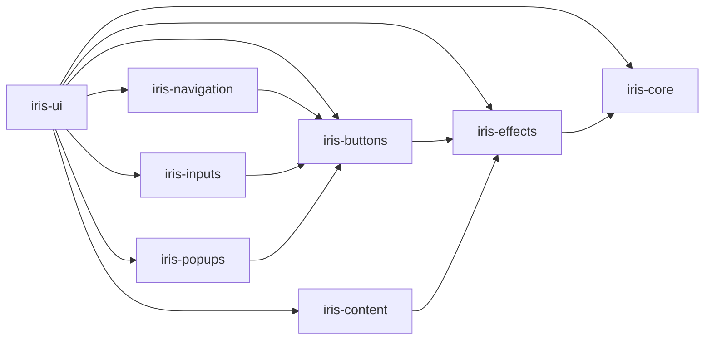

# Documentation

The ColorOS UI Kit is a set of Jetpack Compose modules that recreate the ColorOS 17 look, plus a catalog app that shows
every component. The [project README](../README.md) has the overview, screenshots and recordings. This folder explains how
to use the kit and what is in it.

## Start here

| | |
| --- | --- |
| [Getting started](getting-started.md) | Requirements, adding the modules to a project, a first screen, running the catalog |
| [Catalog tour](catalog.md) | Every screen of the catalog in the dark and the light theme, with the kit APIs it uses |
| [Recordings](recordings.md) | Every screen of the catalog in motion, on one page |
| [API reference](api/README.md) | Every public declaration of every module with its documentation and signature (generated from the source) |

## Guides

| | |
| --- | --- |
| [Theming](theming.md) | Colors, text styles, shapes, motion and icons; dark and light; how to change them |
| [Touch, drag, haptics and overscroll](touch-and-drag.md) | The ColorOS touch animation, which elements drag and why, free drag and re-ordering, glows, haptic events, the bounce at the end of lists |
| [Glass and blur](glass-and-blur.md) | The material of the bottom pill, popups, dialogs and sheets: how to put it on your own surfaces |
| [Navigation](navigation.md) | Scaffolds, collapsing large title, top bar, bottom pill, segmented tabs, page transitions and the back swipe |
| [Popups](popups.md) | Dialogs, bottom sheets and popup menus |
| [FAQ and troubleshooting](faq.md) | Nothing blurs, the back swipe does not follow the finger, a list does not scroll from a button, and similar |

## Background

| | |
| --- | --- |
| [README: how close is it](../README.md#how-close-is-it-to-the-real-thing) | The recorded behaviours next to the same gestures on the catalog |
| [README: measuring against the phone](../README.md#measuring-against-the-phone-tools) | The scripts in `tools/` that record the screen, play touch gestures and analyse the frames |

## The modules

| Module | What is in it | Guide |
| --- | --- | --- |
| `iris-core` | Theme, colors, typography, shapes, motion, icons, press indication, overlay host | [Theming](theming.md) |
| `iris-effects` | Blur backdrop and glass, touch animation, drag physics, haptics, touch glow, persistent glow, overscroll | [Touch](touch-and-drag.md), [Glass](glass-and-blur.md) |
| `iris-navigation` | Scaffolds, large title, top bar, bottom pill, segmented tabs, chips, page transitions, back gesture | [Navigation](navigation.md) |
| `iris-buttons` | Primary, secondary, icon, round plus and text buttons | [Catalog](catalog.md#buttons) |
| `iris-inputs` | Switch, text fields, search bar, checkbox and radio button, slider, number picker, progress | [Catalog](catalog.md#inputs) |
| `iris-content` | Card, list item, grouped list, section header, divider, badge | [Catalog](catalog.md#content) |
| `iris-popups` | Dialog, bottom sheet, popup menu, popup host | [Popups](popups.md) |
| `iris-ui` | Umbrella: `IrisApp` (theme, haptics, popup layer, overscroll) and every module above | [Getting started](getting-started.md) |

Each module can be used on its own; the arrows are the dependencies (see the [API reference](api/README.md) for the exact
`api` and `implementation` edges).

## Keeping the docs in step with the code

`docs/api/` and `docs/catalog.md` are generated: `tools/docs.sh` reads the Kotlin sources (their KDoc comments and
signatures) and the catalog demos and rewrites those files, so a change to a KDoc comment shows up after one run.
`tools/tour.sh` takes the screenshots of the catalog on a connected phone, and `tools/gif.sh` records the moving pictures.
The guides in this folder are written by hand.
