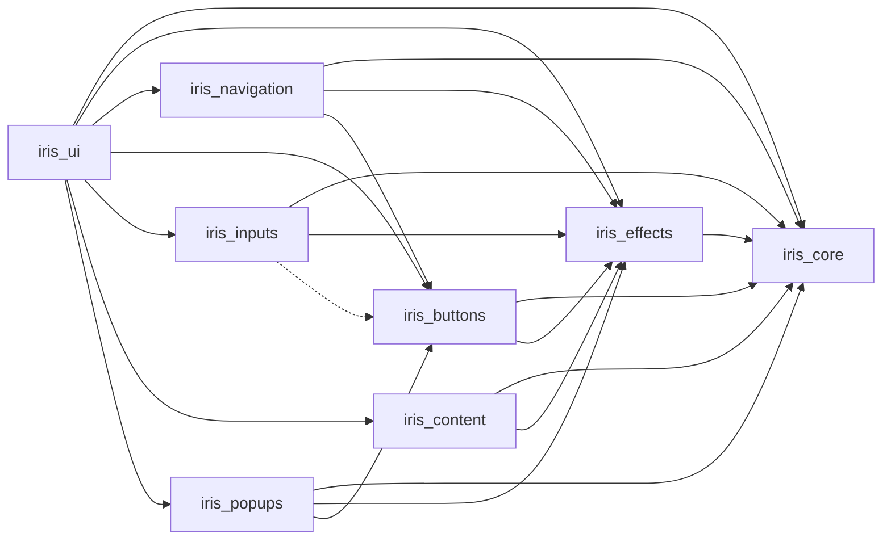

# API reference

Generated from the source and its KDoc by `tools/docs/DocGen.java`: do not edit by hand, change the KDoc in the source and run `tools/docs.sh`.
Every public declaration of every library module is listed, with its signature and a link to the line it is declared on. The [catalog tour](../catalog.md) shows what each of them looks like, the guides in [docs](../README.md) explain how they fit together.

## Modules

Solid arrows are `api` dependencies (their types appear in the public API), dotted ones are `implementation` dependencies.
`iris-ui` is the umbrella: depend on it for the whole kit, or on single modules.

## [iris-core](iris-core.md)

Theme, colors, typography, shapes, motion, icons, overlay host. Package `dev.irisui.core`.

| Declaration | What it is |
| --- | --- |
| [`IrisColors`](iris-core.md#iriscolors) | Color tokens of the ColorOS 17 look. |
| [`IrisBlue`](iris-core.md#irisblue) | ColorOS blue (dark variant). |
| [`IrisSettingsBlue`](iris-core.md#irissettingsblue) | The blue of caret and underline in the text fields of the stock dialogs (measured: #428AF7). |
| [`irisDarkColors`](iris-core.md#irisdarkcolors) | The dark palette of ColorOS 17. |
| [`irisLightColors`](iris-core.md#irislightcolors) | The light palette of ColorOS 17. |
| [`IrisIcons`](iris-core.md#irisicons) | A small stroke-based icon set so the kit has no dependency on an icon library. |
| [`IrisIndication`](iris-core.md#irisindication) | Indication for clickable surfaces that are not list rows (menu items, custom clickables): a flat highlight of the press overlay (20 % white in dark mode, measured on ColorOS Settings rows). |
| [`IrisEasing`](iris-core.md#iriseasing) | Easing curves used by the transitions of the kit. |
| [`IrisMotion`](iris-core.md#irismotion) | Animation specs shared by every component so the whole kit moves the same way. |
| [`SmoothRoundedCornerShape`](iris-core.md#smoothroundedcornershape) | Rounded rectangle with "continuous" (squircle) corners, the corner style ColorOS and iOS use. |
| [`SmoothPillShape`](iris-core.md#smoothpillshape) | Stadium with squircle ends, for everything that is a "pill" in ColorOS: the bottom nav pill, buttons, tabs, search bars. |
| [`IrisShapes`](iris-core.md#irisshapes) | Shape tokens. |
| [`LocalColorOSColors`](iris-core.md#localcoloroscolors) | Colors of the current theme (the dark palette outside a `IrisTheme`); read them through `IrisTheme.colors`. |
| [`LocalColorOSTypography`](iris-core.md#localcolorostypography) | Typography of the current theme; read it through `IrisTheme.typography`. |
| [`LocalColorOSShapes`](iris-core.md#localcolorosshapes) | Shapes of the current theme; read them through `IrisTheme.shapes`. |
| [`LocalColorOSMotion`](iris-core.md#localcolorosmotion) | Motion specs of the current theme; read them through `IrisTheme.motion`. |
| [`LocalContentColor`](iris-core.md#localcontentcolor) | Color text and icons use when they are not given one explicitly. |
| [`IrisTheme`](iris-core.md#iristheme) | Access to the current theme tokens. |
| [`IrisTheme`](iris-core.md#iristheme-1) | Root of the theme. |
| [`IrisText`](iris-core.md#iristext) | Text that resolves its color from `LocalContentColor` and its style from the theme. |
| [`IrisIcon`](iris-core.md#irisicon) | Vector icon tinted with `tint` (default: current content color). |
| [`IrisTypography`](iris-core.md#iristypography) | Text styles. |
| [`OverlayHost`](iris-core.md#overlayhost) | A "portal" layer for dialogs, sheets and popup menus. |
| [`LocalOverlayHost`](iris-core.md#localoverlayhost) | The `OverlayHost` that popups register with; `null` outside a popup host, where popups are composed in place instead. |
| [`OverlayHostLayer`](iris-core.md#overlayhostlayer) | Draws everything that popups registered with `host`. |
| [`OverlayPortal`](iris-core.md#overlayportal) | Renders `content` in the nearest `OverlayHost`; falls back to inline composition when there is none. |
| [`rubberBand`](iris-core.md#rubberband) | Rubber band resistance. |
| [`Modifier.plainClickable`](iris-core.md#modifierplainclickable) | Click without any indication; callers draw their own feedback. |

## [iris-effects](iris-effects.md)

Blur backdrop, press, haptics, touch glow, persistent glow, drag physics. Package `dev.irisui.effects`.

| Declaration | What it is |
| --- | --- |
| [`Backdrop`](iris-effects.md#backdrop) | The content that glass surfaces blur. |
| [`rememberBackdrop`](iris-effects.md#rememberbackdrop) | Creates and remembers a `Backdrop`: mark the content to blur with `backdropSource` and draw glass surfaces above it with `glass`. |
| [`LocalBackdrop`](iris-effects.md#localbackdrop) | Backdrop that glass surfaces use when none is passed explicitly. |
| [`Modifier.backdropSource`](iris-effects.md#modifierbackdropsource) | Records this content into `backdrop` (and still draws it normally). |
| [`GlassFade`](iris-effects.md#glassfade) | Direction in which a surface fades out (progressive blur for top and bottom bars). |
| [`Modifier.verticalFadeMask`](iris-effects.md#modifierverticalfademask) | Fades the content of this element out along the vertical axis. |
| [`GlassStyle`](iris-effects.md#glassstyle) | Everything that makes up a glass surface: the `material` (blur plus colour layers, see `GlassMaterial`) and the edge decoration (rim light and the soft light along the inner bottom edge). |
| [`GlassDefaults`](iris-effects.md#glassdefaults) | Ready-made `GlassStyle`s for the glass surfaces of ColorOS 17 (bottom pill, toolbar buttons, popup menu, dialog, bottom sheet, search bar) and builders for your own. |
| [`Modifier.glass`](iris-effects.md#modifierglass) | Turns this element into a glass surface: it draws a blurred copy of `backdrop` clipped to `shape`, runs it through the colour layers of the material and adds a light rim. |
| [`PhysicsDragState`](iris-effects.md#physicsdragstate) | State of a freely draggable element. |
| [`rememberPhysicsDragState`](iris-effects.md#rememberphysicsdragstate) | Remembers the `PhysicsDragState` of one element that uses `physicsDrag`. |
| [`Modifier.physicsDrag`](iris-effects.md#modifierphysicsdrag) | Makes the element draggable in any direction with physics: rubber band past `maxDistance`, a lift while held, tilt from the drag direction and a springy return. |
| [`ReorderableColumn`](iris-effects.md#reorderablecolumn) | A column whose items can be re-ordered by dragging their `handle`. |
| [`GlassLayer`](iris-effects.md#glasslayer) | One colour layer of a glass material. |
| [`GlassMaterial`](iris-effects.md#glassmaterial) | The recipe of every glass surface of ColorOS 17, matched on a OnePlus 15: the backdrop is blurred with a Gaussian of `blur`, then passed through `layers`, each one a colour blended with its own blend mode. |
| [`GlassMaterials`](iris-effects.md#glassmaterials) | The materials of ColorOS 17, matched on a OnePlus 15: view level materials (bars, buttons) and window level materials (popup menu, dialog, bottom sheet). |
| [`Modifier.persistentGlow`](iris-effects.md#modifierpersistentglow) | The always-on colored light that sits under ColorOS buttons (round plus button, primary button, glass icon buttons). |
| [`Modifier.touchGlow`](iris-effects.md#modifiertouchglow) | Soft light that follows the finger inside the element while it is touched and fades out after release. |
| [`IrisHaptic`](iris-effects.md#irishaptic) | Semantic haptic events. |
| [`IrisHapticConstants`](iris-effects.md#irishapticconstants) | The haptic constants of ColorOS, accepted by `View.performHapticFeedback` on ColorOS / OxygenOS devices. |
| [`HapticSource`](iris-effects.md#hapticsource) | Where haptics come from. |
| [`IrisHaptics`](iris-effects.md#irishaptics) | Plays `IrisHaptic` events on the device. |
| [`NoOpHaptics`](iris-effects.md#noophaptics) | Haptics that do nothing: the default outside `IrisApp`, and what previews and tests use. |
| [`LocalColorOSHaptics`](iris-effects.md#localcoloroshaptics) | The haptics the components fire their events through: `NoOpHaptics` unless `IrisApp` or your own provider supplies real ones. |
| [`rememberColorOSHaptics`](iris-effects.md#remembercoloroshaptics) | Creates `AndroidColorOSHaptics` for the current view and remembers it. |
| [`AndroidColorOSHaptics`](iris-effects.md#androidcoloroshaptics) | `IrisHaptics` on the vibrator of the device. |
| [`isOplusDevice`](iris-effects.md#isoplusdevice) | True on ColorOS / OxygenOS devices (OPPO, OnePlus, realme), which accept the ColorOS haptic constants. |
| [`IrisOverscrollFactory`](iris-effects.md#irisoverscrollfactory) | Overscroll of the stock apps instead of the Android stretch: when a list is pulled past its end the content simply translates, and springs back when the finger lets go. |
| [`Modifier.irisClickable`](iris-effects.md#modifieririsclickable) | Click with ColorOS feedback: an optional indication and a haptic event. |
| [`ProgressiveBlur`](iris-effects.md#progressiveblur) | The blur under a top bar. |
| [`TouchSpring`](iris-effects.md#touchspring) | A spring described by a `bounce` and a `duration` (the time of one natural oscillation, in seconds). |
| [`TouchDragAxes`](iris-effects.md#touchdragaxes) | Which axes follow the finger while the element is held. |
| [`TouchMotionDefaults`](iris-effects.md#touchmotiondefaults) | The constants of the ColorOS 17 touch animation. |
| [`TouchMotionMath`](iris-effects.md#touchmotionmath) | The formulas behind the touch animation. |
| [`TouchMotionState`](iris-effects.md#touchmotionstate) | Animation state of one touchable element: the shrink of the press, the rubber-band translation and the stretch / squeeze while dragged, and the lighter fill. |
| [`rememberTouchMotionState`](iris-effects.md#remembertouchmotionstate) | Remembers the `TouchMotionState` of one element. |
| [`Modifier.touchMotion`](iris-effects.md#modifiertouchmotion) | The ColorOS 17 touch animation. |

## [iris-navigation](iris-navigation.md)

Bottom nav pill, top bar, large title, segmented tabs, page transitions. Package `dev.irisui.navigation`.

| Declaration | What it is |
| --- | --- |
| [`IrisBackGestureTracking`](iris-navigation.md#irisbackgesturetracking) | Lets the system tell a single-activity app where the finger is during the edge back gesture, so that `PredictiveBackHandler` can animate with the finger (the page follows it 1:1). |
| [`BackEventCompat.travelFromEdge`](iris-navigation.md#backeventcompattravelfromedge) | How far the finger has come from the edge this gesture started at, in px: `touchX` for a swipe from the left edge, `width - touchX` for one from the right edge. |
| [`NavItem`](iris-navigation.md#navitem) | One tab of `IrisBottomNavPill`. |
| [`IrisBottomNavPill`](iris-navigation.md#irisbottomnavpill) | The floating glass pill at the bottom of ColorOS apps. |
| [`IrisChip`](iris-navigation.md#irischip) | Chip of a single choice row (repeat type of an alarm, filters): 32 dp high pill, 14 sp label, 12 dp padding. |
| [`IrisChipRow`](iris-navigation.md#irischiprow) | Horizontally scrolling row of chips: 20 dp from the screen edge, 8 dp between chips, the end fades out like the real row does when more chips are hidden behind the edge. |
| [`PageAction`](iris-navigation.md#pageaction) | What the last navigation did: a page was pushed or popped (see `PageStack.lastAction`). |
| [`PageStack`](iris-navigation.md#pagestack) | Minimal back stack for `IrisPageHost`. |
| [`rememberPageStack`](iris-navigation.md#rememberpagestack) | Remembers a `PageStack` that starts with `initial`. |
| [`IrisPageHost`](iris-navigation.md#irispagehost) | Hosts the pages of a `PageStack` with the ColorOS page transition and the back gesture, measured on the Settings app of a OnePlus 15: |
| [`IrisScaffold`](iris-navigation.md#irisscaffold) | Page scaffold. |
| [`LargeTitleScope`](iris-navigation.md#largetitlescope) | Gives pages a `LargeTitle` to place as the first item of their scrolling content. |
| [`IrisLargeTitleScaffold`](iris-navigation.md#irislargetitlescaffold) | Collapsing large title. |
| [`LazyListState.titleScrollOffset`](iris-navigation.md#lazyliststatetitlescrolloffset) | Scroll offset (px) for a lazy list, for `IrisLargeTitleScaffold`. |
| [`IrisSegmentedTabs`](iris-navigation.md#irissegmentedtabs) | Segmented control of the Battery page: a 40 dp track, a neutral 32 dp thumb 4 dp inside it, and labels that keep one color. |
| [`IrisTopBarDefaults`](iris-navigation.md#iristopbardefaults) | Measures of the top bar. |
| [`IrisTopBar`](iris-navigation.md#iristopbar) | Compact top bar: round back button, a title that sits next to it and round action buttons. |
| [`IrisBackButton`](iris-navigation.md#irisbackbutton) | Round glass back button for `IrisTopBar`. |

## [iris-buttons](iris-buttons.md)

Primary, secondary, icon, round plus, text. Package `dev.irisui.buttons`.

| Declaration | What it is |
| --- | --- |
| [`IrisPrimaryButton`](iris-buttons.md#irisprimarybutton) | Filled accent pill with the persistent colored glow underneath. |
| [`IrisSecondaryButton`](iris-buttons.md#irissecondarybutton) | Neutral pill for secondary actions. |
| [`IconButtonStyle`](iris-buttons.md#iconbuttonstyle) | Look of a `IrisIconButton`: `Glass` is the round glass button of the top bars, `Filled` the accent coloured one with its glow, `Plain` is just the icon. |
| [`IrisIconButton`](iris-buttons.md#irisiconbutton) | Round icon button (the round buttons of the top bar included). |
| [`IrisRoundPlusButton`](iris-buttons.md#irisroundplusbutton) | The big round "+" button. |
| [`IrisTextButton`](iris-buttons.md#iristextbutton) | Text-only action in the accent color. |

## [iris-inputs](iris-inputs.md)

Switch, text field, search bar, checkbox, slider. Package `dev.irisui.inputs`.

| Declaration | What it is |
| --- | --- |
| [`IrisCheckbox`](iris-inputs.md#irischeckbox) | Rounded-square checkbox, 18 dp inside a 30 dp touch area, as in the selection mode of the stock apps: a 1.7 dp ring in the faint label color turns into an accent filled square with a white check that draws itself. |
| [`IrisRadioButton`](iris-inputs.md#irisradiobutton) | Radio button: 20 dp. |
| [`IrisNumberPicker`](iris-inputs.md#irisnumberpicker) | Wheel for numbers (hours, minutes, durations), three rows high: the centered value in the label color at 22 sp, the neighbours at 17 sp and 30 % brightness, as in the Clock sheets. |
| [`IrisProgressBar`](iris-inputs.md#irisprogressbar) | Horizontal progress bar, measured on the storage card of the Files app: 8 dp high, fully rounded track in the same tone as the empty part of a slider, the accent fill ends in a straight edge. |
| [`IrisProgressBar`](iris-inputs.md#irisprogressbar-1) | Progress bar that does not know how far it is: a quarter of the bar sweeps back and forth. |
| [`IrisLoadingSpinner`](iris-inputs.md#irisloadingspinner) | Round loading indicator: an accent arc of 270 degrees turning once a second. |
| [`IrisCircularProgress`](iris-inputs.md#iriscircularprogress) | Ring that fills like a progress bar. |
| [`IrisSlider`](iris-inputs.md#irisslider) | Thick ColorOS slider, rebuilt from recordings of the volume rows of Settings and the Icons page of the theme app: |
| [`IrisSwitch`](iris-inputs.md#irisswitch) | ColorOS switch: 44 x 24 dp track, 18 dp white thumb with 3 dp margins. |
| [`IrisTextField`](iris-inputs.md#iristextfield) | Filled text field with a rounded container. |
| [`IrisUnderlineTextField`](iris-inputs.md#irisunderlinetextfield) | Text field of the stock dialogs (the "Change device name" dialog of Settings): the text sits on a bare 48 dp row with a 1 dp underline that turns blue while the field has focus. |
| [`IrisSearchBar`](iris-inputs.md#irissearchbar) | Pill-shaped search bar. |

## [iris-content](iris-content.md)

Card, list item, grouped list, section header, divider. Package `dev.irisui.content`.

| Declaration | What it is |
| --- | --- |
| [`IrisRedDot`](iris-content.md#irisreddot) | Red dot that hints at something new (no number): 8 dp, the destructive container red. |
| [`IrisBadge`](iris-content.md#irisbadge) | Red badge with a count: a pill at least 16 dp high with white digits (11 sp); counts above `max` read "max+". |
| [`IrisCard`](iris-content.md#iriscard) | Rounded surface for grouping content. |
| [`IrisListItem`](iris-content.md#irislistitem) | A row as used throughout ColorOS Settings: optional leading icon, title with an optional summary, a trailing value / chevron / custom control. |
| [`IrisListIcon`](iris-content.md#irislisticon) | Free-standing colored glyph as used in Settings rows (24 dp box: the text then starts 56 dp from the card edge). |
| [`IrisIconTile`](iris-content.md#irisicontile) | Glyph on a rounded colored tile, as used in the Files app. |
| [`GroupedListScope`](iris-content.md#groupedlistscope) | Scope of the content of `IrisGroupedList`: add the rows with `item`. |
| [`IrisGroupedList`](iris-content.md#irisgroupedlist) | A card that holds several rows separated by inset dividers. |
| [`IrisSectionHeader`](iris-content.md#irissectionheader) | Small gray caption above a group of rows ("Volume", "Sound effects"). |
| [`IrisDivider`](iris-content.md#irisdivider) | Hairline divider. |

## [iris-popups](iris-popups.md)

Dialog, bottom sheet, popup menu. Package `dev.irisui.popups`.

| Declaration | What it is |
| --- | --- |
| [`IrisBottomSheet`](iris-popups.md#irisbottomsheet) | Bottom sheet. |
| [`IrisDialog`](iris-popups.md#irisdialog) | Confirmation dialog. |
| [`IrisDialogContainer`](iris-popups.md#irisdialogcontainer) | Dialog shell without any content, for fully custom dialogs. |
| [`IrisPopupHost`](iris-popups.md#irispopuphost) | Wrap the whole app (or one screen) in this host. |
| [`IrisPopupMenuBox`](iris-popups.md#irispopupmenubox) | Anchors a popup menu to `anchor`. |
| [`IrisMenuItem`](iris-popups.md#irismenuitem) | One row of a popup menu: 40 dp high, text 20 dp from the panel edge (15 sp). |
| [`IrisMenuDivider`](iris-popups.md#irismenudivider) | Divider between groups of rows: the same hairline as the dividers of lists and menus (`IrisTheme` divider colour, one device pixel high), inset by the 20 dp side padding of the rows. |

## [iris-ui](iris-ui.md)

Umbrella: depends on every module above. Package `dev.irisui.ui`.

| Declaration | What it is |
| --- | --- |
| [`IrisApp`](iris-ui.md#irisapp) | One-stop root for an app that uses the whole kit: theme, haptics engine and the popup layer (dialogs, sheets, menus). |

