# Catalog tour

Every screen of the catalog app next to the kit APIs it uses, in the dark and in the light theme. The screenshots were taken on a OnePlus 15 (ColorOS 17.0.1) and show the first screen of each demo with the status bar cropped; click one for the full size. Where a recording exists it is shown below the description. All recordings are also on [one page](recordings.md). The last section has example screens that put the components together into whole pages.

Every screen can be opened directly:

```
adb shell am start -n dev.irisui.catalog/.MainActivity --es destination Slider
```

Add `--ez light true` for the light theme and `--ez touches true` for a circle under the finger (for screen recordings). The name after `--es destination` is the entry of `CatalogDestination`. This page is generated by `tools/docs/DocGen.java`; the screenshots by `tools/tour.sh`.

## Navigation

<table>
<tr>
<td valign="top" width="34%"><a id="bottomnavpill"></a><b>Bottom nav pill</b><br>Tap, or slide a finger across the pill<br><sub>Uses <a href="api/iris-navigation.md#navitem"><code>NavItem</code></a>, <a href="api/iris-navigation.md#irislargetitlescaffold"><code>IrisLargeTitleScaffold</code></a>, <a href="api/iris-navigation.md#lazyliststatetitlescrolloffset"><code>LazyListState.titleScrollOffset</code></a>, <a href="api/iris-navigation.md#irisbackbutton"><code>IrisBackButton</code></a>, <a href="api/iris-navigation.md#irisbottomnavpill"><code>IrisBottomNavPill</code></a>, <a href="api/iris-buttons.md#irisroundplusbutton"><code>IrisRoundPlusButton</code></a>, <a href="api/iris-content.md#irissectionheader"><code>IrisSectionHeader</code></a></sub><br><sub><code>--es destination BottomNavPill</code> · <a href="../catalog/src/main/kotlin/dev/irisui/catalog/demos/NavigationDemos.kt">source</a></sub><br>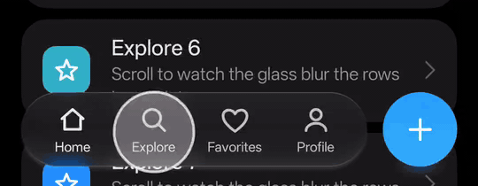<br>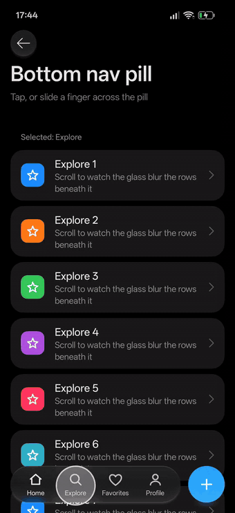</td>
<td valign="top" align="center"><a href="media/catalog/dark/BottomNavPill.png">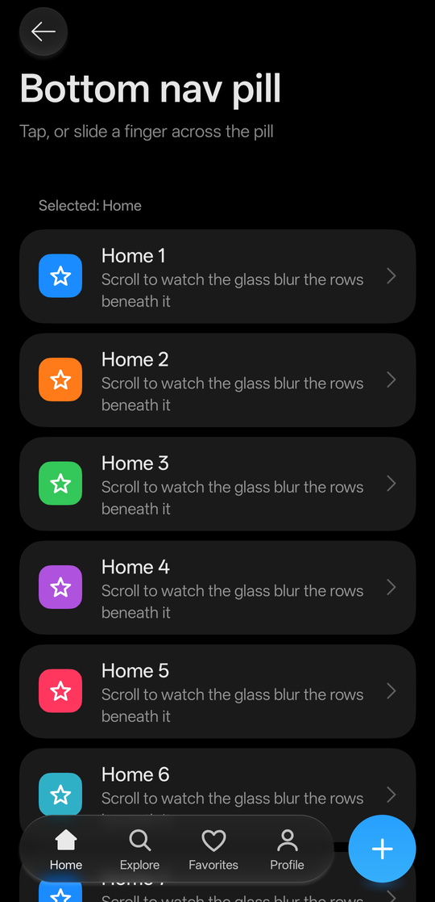</a><br><sub>dark</sub></td>
<td valign="top" align="center"><a href="media/catalog/light/BottomNavPill.png">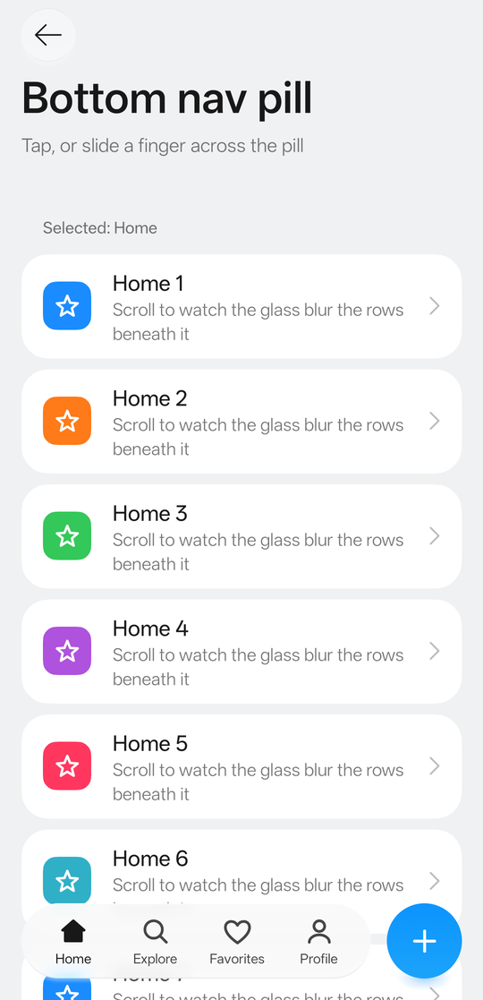</a><br><sub>light</sub></td>
</tr>
<tr>
<td valign="top" width="34%"><a id="topbar"></a><b>Top bar</b><br>Glass top bar with a back button, a centred title and actions<br><sub>Uses <a href="api/iris-navigation.md#irisscaffold"><code>IrisScaffold</code></a>, <a href="api/iris-navigation.md#iristopbar"><code>IrisTopBar</code></a>, <a href="api/iris-navigation.md#irisbackbutton"><code>IrisBackButton</code></a>, <a href="api/iris-buttons.md#irisiconbutton"><code>IrisIconButton</code></a>, <a href="api/iris-popups.md#irispopupmenubox"><code>IrisPopupMenuBox</code></a>, <a href="api/iris-popups.md#irismenuitem"><code>IrisMenuItem</code></a>, <a href="api/iris-popups.md#irismenudivider"><code>IrisMenuDivider</code></a>, <a href="api/iris-navigation.md#lazyliststatetitlescrolloffset"><code>LazyListState.titleScrollOffset</code></a></sub><br><sub><code>--es destination TopBar</code> · <a href="../catalog/src/main/kotlin/dev/irisui/catalog/demos/NavigationDemos.kt">source</a></sub><br>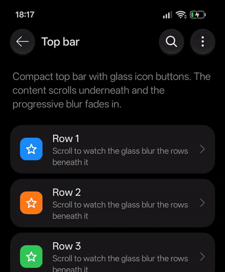</td>
<td valign="top" align="center"><a href="media/catalog/dark/TopBar.png">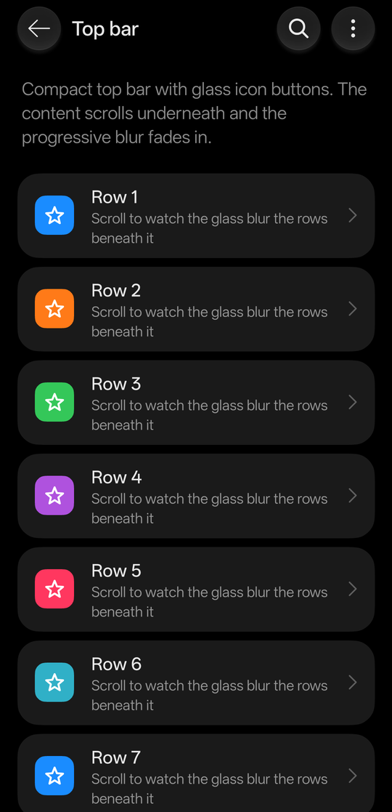</a><br><sub>dark</sub></td>
<td valign="top" align="center"><a href="media/catalog/light/TopBar.png">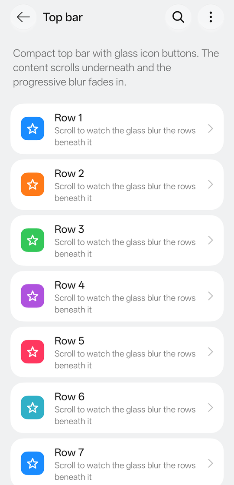</a><br><sub>light</sub></td>
</tr>
<tr>
<td valign="top" width="34%"><a id="largetitle"></a><b>Collapsing large title</b><br>A large title that collapses into the top bar while the list scrolls under it<br><sub>Uses <a href="api/iris-navigation.md#irislargetitlescaffold"><code>IrisLargeTitleScaffold</code></a>, <a href="api/iris-navigation.md#lazyliststatetitlescrolloffset"><code>LazyListState.titleScrollOffset</code></a>, <a href="api/iris-navigation.md#irisbackbutton"><code>IrisBackButton</code></a>, <a href="api/iris-buttons.md#irisiconbutton"><code>IrisIconButton</code></a></sub><br><sub><code>--es destination LargeTitle</code> · <a href="../catalog/src/main/kotlin/dev/irisui/catalog/demos/NavigationDemos.kt">source</a></sub><br>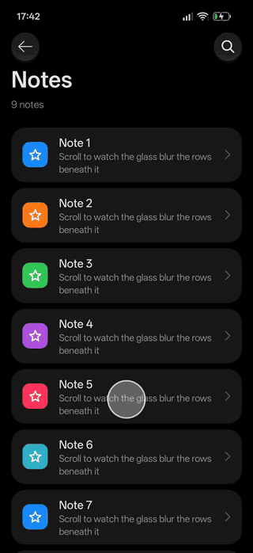</td>
<td valign="top" align="center"><a href="media/catalog/dark/LargeTitle.png">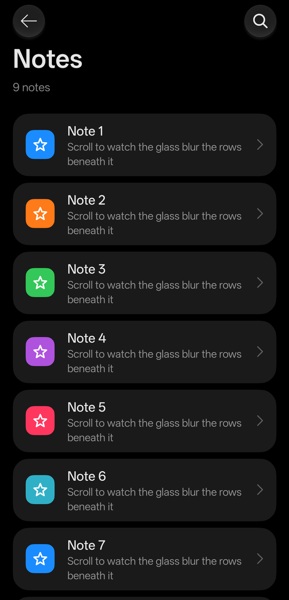</a><br><sub>dark</sub></td>
<td valign="top" align="center"><a href="media/catalog/light/LargeTitle.png">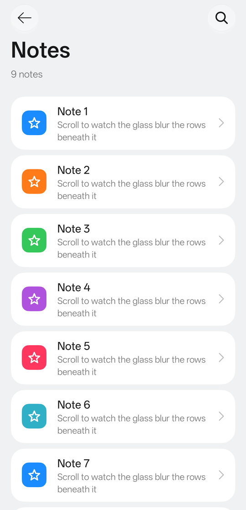</a><br><sub>light</sub></td>
</tr>
<tr>
<td valign="top" width="34%"><a id="segmentedtabs"></a><b>Segmented tabs</b><br>Slide the thumb or tap a segment<br><sub>Uses <a href="api/iris-navigation.md#irissegmentedtabs"><code>IrisSegmentedTabs</code></a></sub><br><sub><code>--es destination SegmentedTabs</code> · <a href="../catalog/src/main/kotlin/dev/irisui/catalog/demos/NavigationDemos.kt">source</a></sub><br>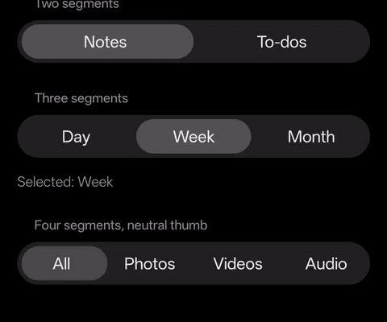</td>
<td valign="top" align="center"><a href="media/catalog/dark/SegmentedTabs.png">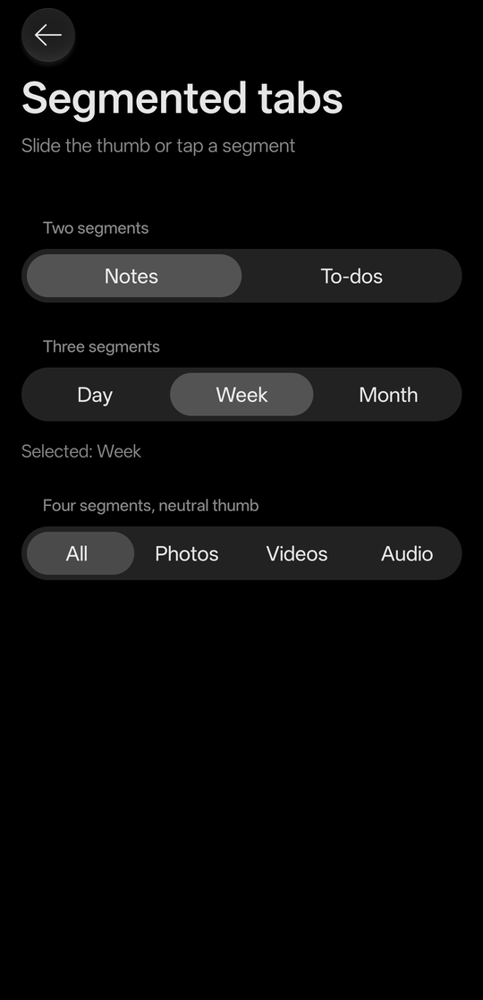</a><br><sub>dark</sub></td>
<td valign="top" align="center"><a href="media/catalog/light/SegmentedTabs.png">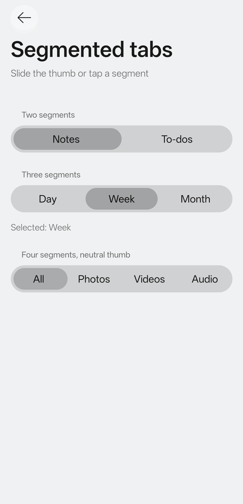</a><br><sub>light</sub></td>
</tr>
<tr>
<td valign="top" width="34%"><a id="pagetransitions"></a><b>Page transitions</b><br>Every screen in this catalog uses them<br><sub>Uses <a href="api/iris-buttons.md#irisprimarybutton"><code>IrisPrimaryButton</code></a></sub><br><sub><code>--es destination PageTransitions</code> · <a href="../catalog/src/main/kotlin/dev/irisui/catalog/demos/NavigationDemos.kt">source</a></sub><br>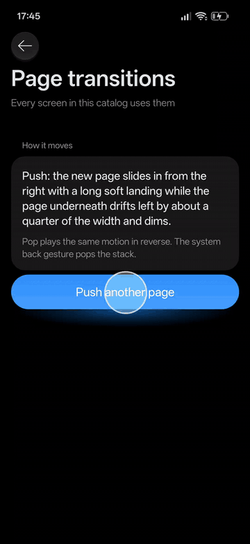</td>
<td valign="top" align="center"><a href="media/catalog/dark/PageTransitions.png">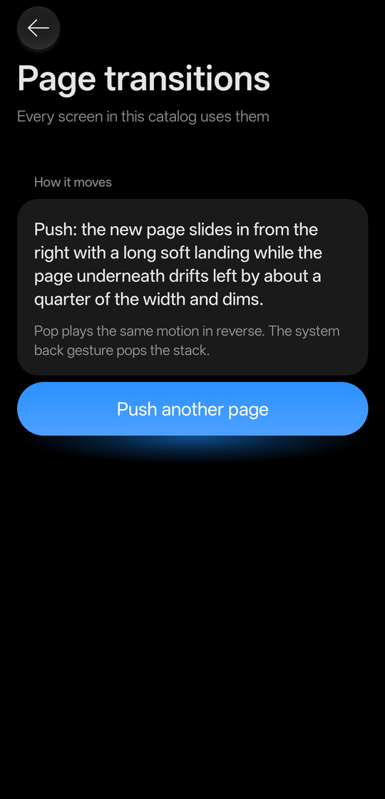</a><br><sub>dark</sub></td>
<td valign="top" align="center"><a href="media/catalog/light/PageTransitions.png">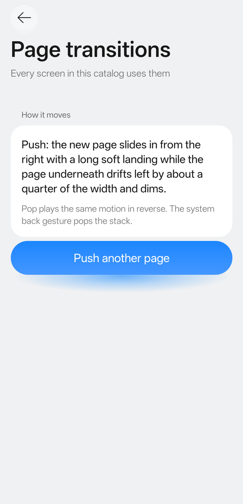</a><br><sub>light</sub></td>
</tr>
</table>

## Buttons

<table>
<tr>
<td valign="top" width="34%"><a id="primarybutton"></a><b>Primary button</b><br>Accent pill with a glow that is always on<br><sub>Uses <a href="api/iris-buttons.md#irisprimarybutton"><code>IrisPrimaryButton</code></a></sub><br><sub><code>--es destination PrimaryButton</code> · <a href="../catalog/src/main/kotlin/dev/irisui/catalog/demos/ButtonsDemos.kt">source</a></sub><br>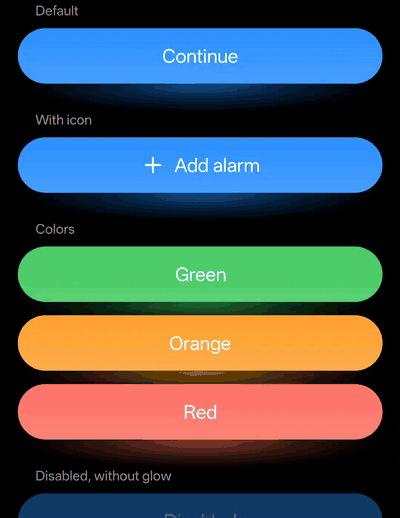</td>
<td valign="top" align="center"><a href="media/catalog/dark/PrimaryButton.png">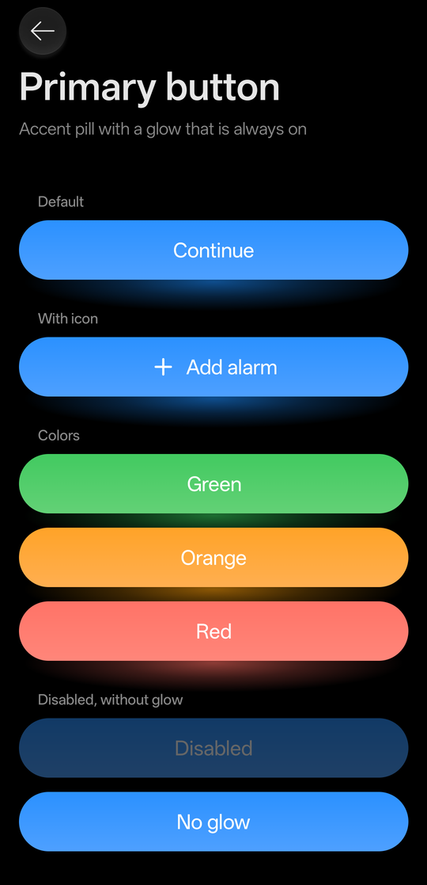</a><br><sub>dark</sub></td>
<td valign="top" align="center"><a href="media/catalog/light/PrimaryButton.png">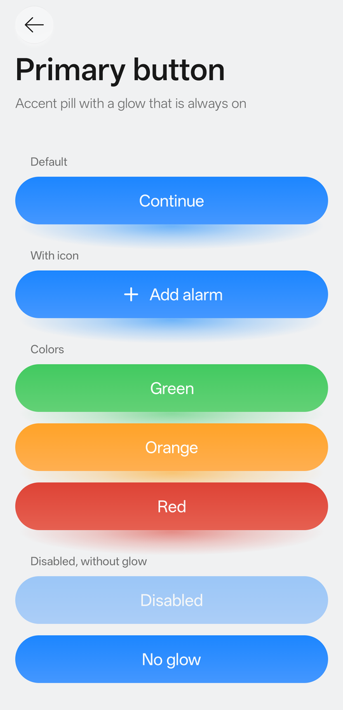</a><br><sub>light</sub></td>
</tr>
<tr>
<td valign="top" width="34%"><a id="secondarybutton"></a><b>Secondary button</b><br>Quiet pill for the second choice<br><sub>Uses <a href="api/iris-buttons.md#irissecondarybutton"><code>IrisSecondaryButton</code></a>, <a href="api/iris-buttons.md#irisprimarybutton"><code>IrisPrimaryButton</code></a></sub><br><sub><code>--es destination SecondaryButton</code> · <a href="../catalog/src/main/kotlin/dev/irisui/catalog/demos/ButtonsDemos.kt">source</a></sub><br>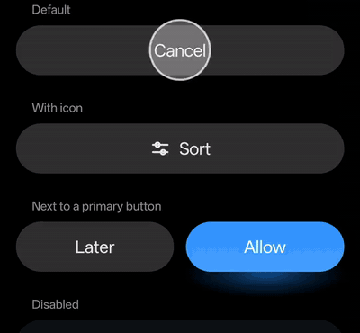</td>
<td valign="top" align="center"><a href="media/catalog/dark/SecondaryButton.png">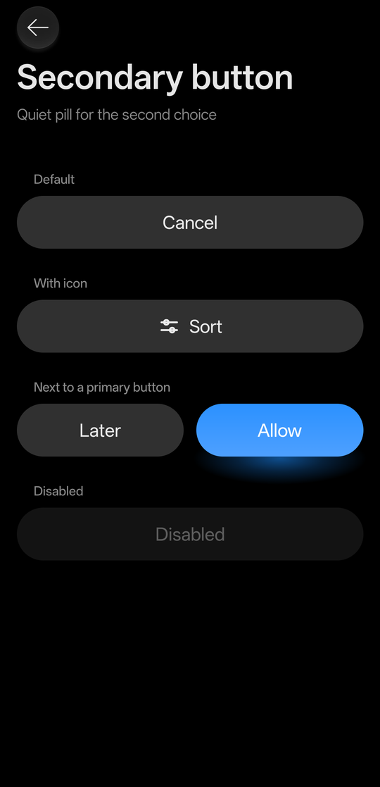</a><br><sub>dark</sub></td>
<td valign="top" align="center"><a href="media/catalog/light/SecondaryButton.png">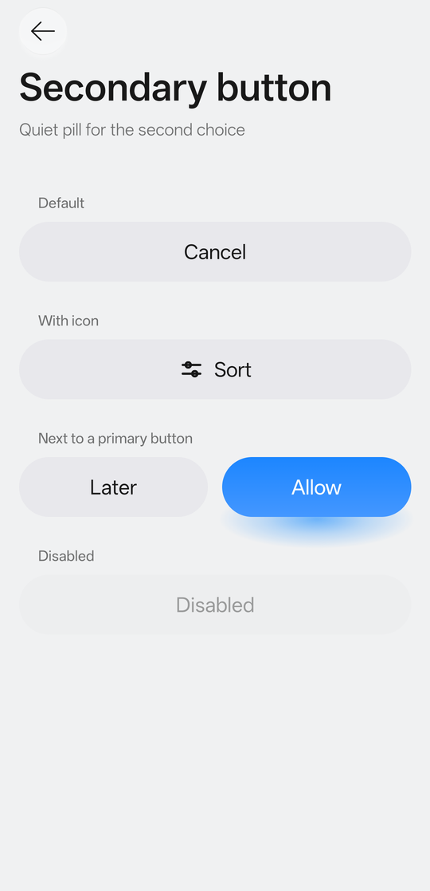</a><br><sub>light</sub></td>
</tr>
<tr>
<td valign="top" width="34%"><a id="iconbutton"></a><b>Icon button</b><br>Round glass, filled and plain<br><sub>Uses <a href="api/iris-buttons.md#irisiconbutton"><code>IrisIconButton</code></a>, <a href="api/iris-effects.md#rememberbackdrop"><code>rememberBackdrop</code></a>, <a href="api/iris-effects.md#modifierbackdropsource"><code>Modifier.backdropSource</code></a>, <a href="api/iris-effects.md#localbackdrop"><code>LocalBackdrop</code></a>, <a href="api/iris-buttons.md#iconbuttonstyle"><code>IconButtonStyle</code></a></sub><br><sub><code>--es destination IconButton</code> · <a href="../catalog/src/main/kotlin/dev/irisui/catalog/demos/ButtonsDemos.kt">source</a></sub></td>
<td valign="top" align="center"><a href="media/catalog/dark/IconButton.png">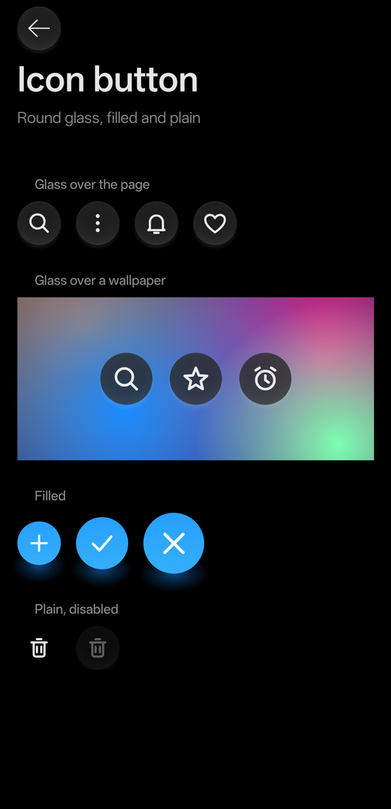</a><br><sub>dark</sub></td>
<td valign="top" align="center"><a href="media/catalog/light/IconButton.png">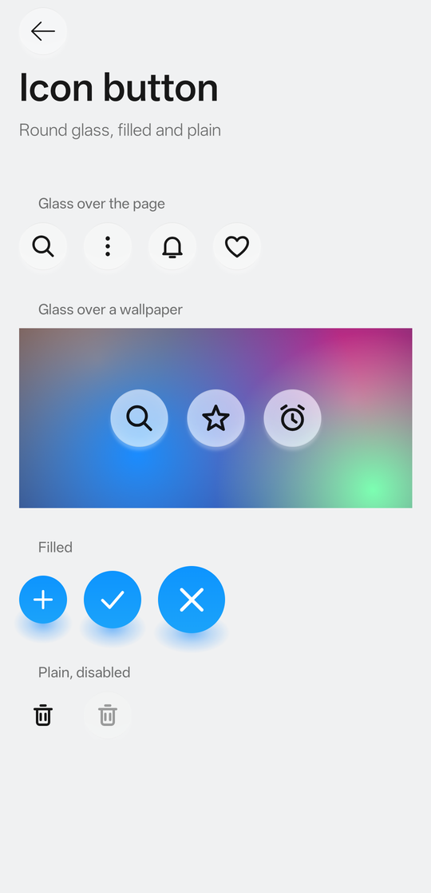</a><br><sub>light</sub></td>
</tr>
<tr>
<td valign="top" width="34%"><a id="roundplusbutton"></a><b>Round plus button</b><br>Press and hold: it shrinks. Drag: it stretches<br><sub>Uses <a href="api/iris-buttons.md#irisroundplusbutton"><code>IrisRoundPlusButton</code></a></sub><br><sub><code>--es destination RoundPlusButton</code> · <a href="../catalog/src/main/kotlin/dev/irisui/catalog/demos/ButtonsDemos.kt">source</a></sub><br>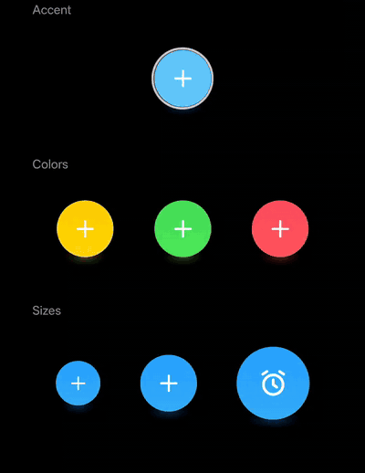</td>
<td valign="top" align="center"><a href="media/catalog/dark/RoundPlusButton.png">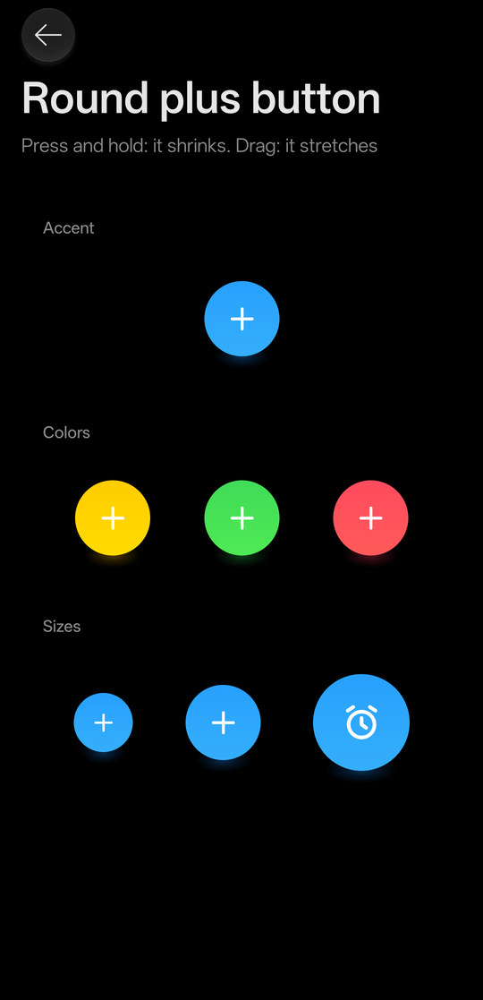</a><br><sub>dark</sub></td>
<td valign="top" align="center"><a href="media/catalog/light/RoundPlusButton.png">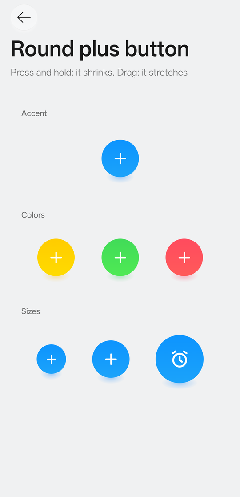</a><br><sub>light</sub></td>
</tr>
<tr>
<td valign="top" width="34%"><a id="textbutton"></a><b>Text button</b><br>Accent text, lights up while pressed<br><sub>Uses <a href="api/iris-buttons.md#iristextbutton"><code>IrisTextButton</code></a></sub><br><sub><code>--es destination TextButton</code> · <a href="../catalog/src/main/kotlin/dev/irisui/catalog/demos/ButtonsDemos.kt">source</a></sub><br>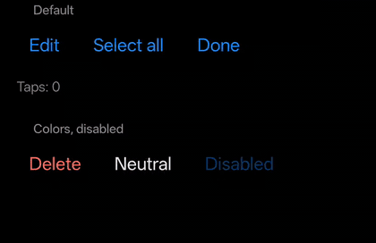</td>
<td valign="top" align="center"><a href="media/catalog/dark/TextButton.png">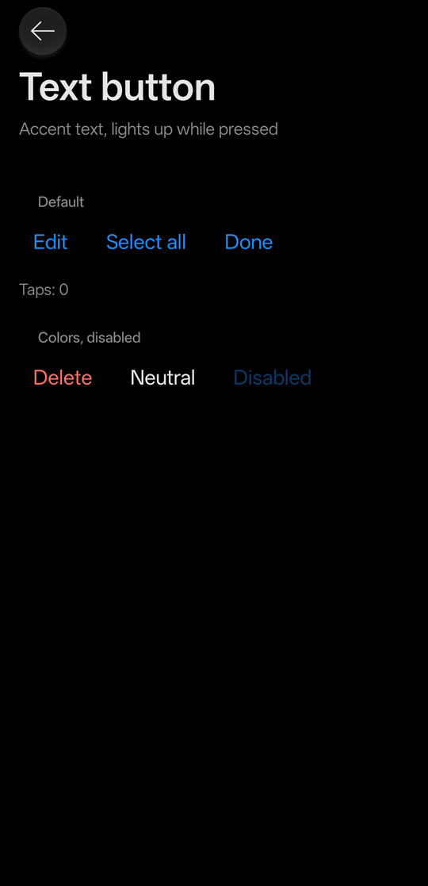</a><br><sub>dark</sub></td>
<td valign="top" align="center"><a href="media/catalog/light/TextButton.png">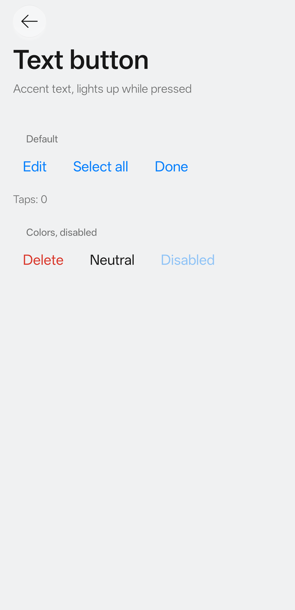</a><br><sub>light</sub></td>
</tr>
</table>

## Inputs

<table>
<tr>
<td valign="top" width="34%"><a id="switch"></a><b>Switch</b><br>Springs across and ticks the haptics<br><sub>Uses <a href="api/iris-content.md#irisgroupedlist"><code>IrisGroupedList</code></a>, <a href="api/iris-content.md#irislistitem"><code>IrisListItem</code></a>, <a href="api/iris-content.md#irislisticon"><code>IrisListIcon</code></a>, <a href="api/iris-inputs.md#irisswitch"><code>IrisSwitch</code></a></sub><br><sub><code>--es destination Switch</code> · <a href="../catalog/src/main/kotlin/dev/irisui/catalog/demos/InputsDemos.kt">source</a></sub><br>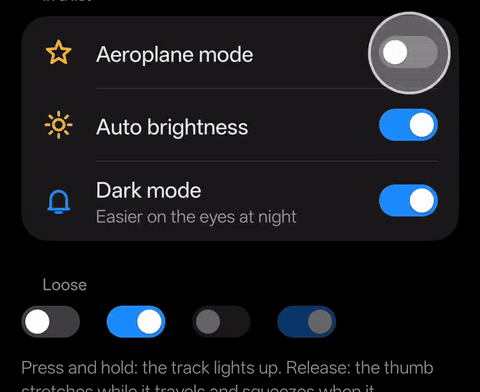</td>
<td valign="top" align="center"><a href="media/catalog/dark/Switch.png">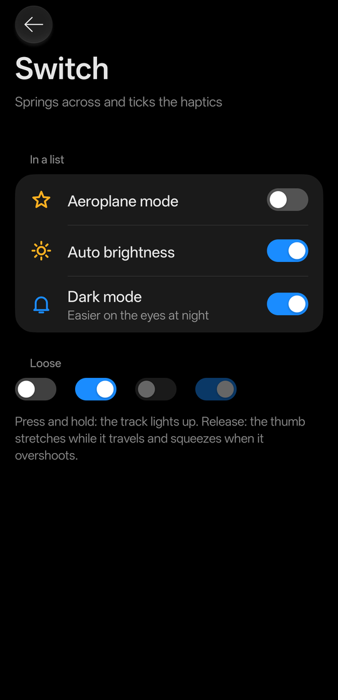</a><br><sub>dark</sub></td>
<td valign="top" align="center"><a href="media/catalog/light/Switch.png">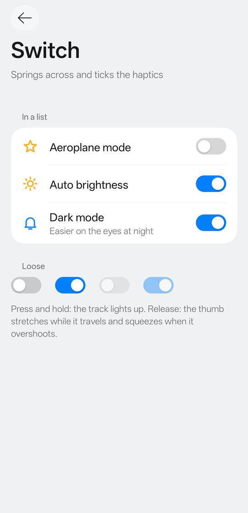</a><br><sub>light</sub></td>
</tr>
<tr>
<td valign="top" width="34%"><a id="textfield"></a><b>Text field</b><br>Rounded fill, accent border on focus<br><sub>Uses <a href="api/iris-inputs.md#iristextfield"><code>IrisTextField</code></a></sub><br><sub><code>--es destination TextField</code> · <a href="../catalog/src/main/kotlin/dev/irisui/catalog/demos/InputsDemos.kt">source</a></sub><br>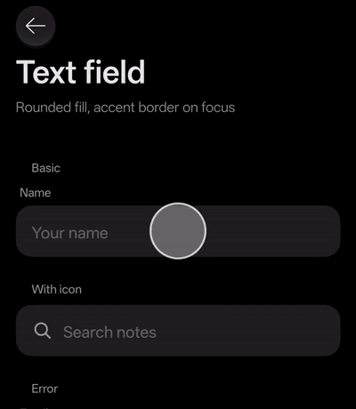</td>
<td valign="top" align="center"><a href="media/catalog/dark/TextField.png">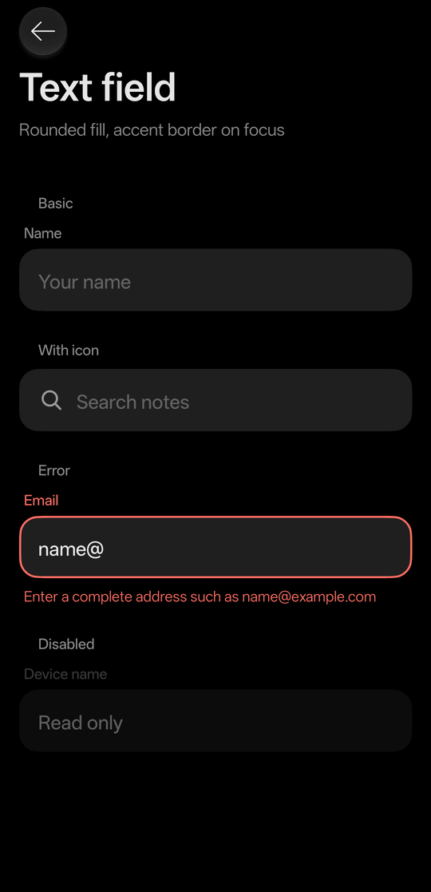</a><br><sub>dark</sub></td>
<td valign="top" align="center"><a href="media/catalog/light/TextField.png">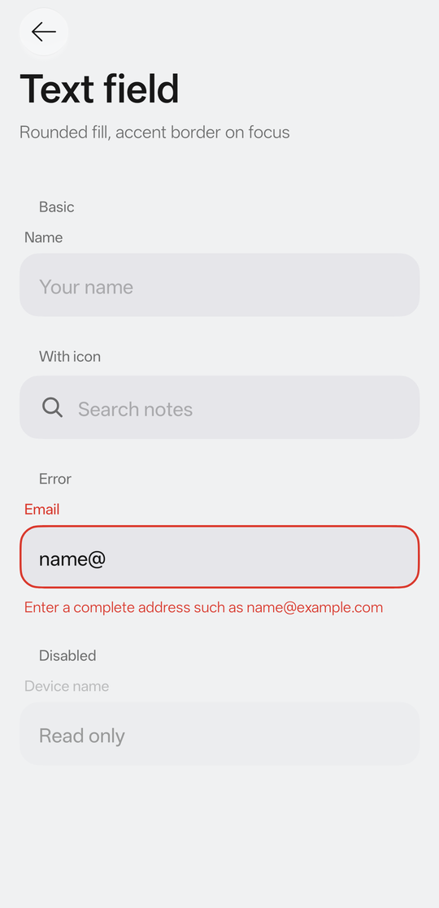</a><br><sub>light</sub></td>
</tr>
<tr>
<td valign="top" width="34%"><a id="searchbar"></a><b>Search bar</b><br>Tap it: a Cancel action slides in<br><sub>Uses <a href="api/iris-inputs.md#irissearchbar"><code>IrisSearchBar</code></a>, <a href="api/iris-content.md#irisgroupedlist"><code>IrisGroupedList</code></a>, <a href="api/iris-content.md#irislistitem"><code>IrisListItem</code></a>, <a href="api/iris-effects.md#rememberbackdrop"><code>rememberBackdrop</code></a>, <a href="api/iris-effects.md#modifierbackdropsource"><code>Modifier.backdropSource</code></a>, <a href="api/iris-effects.md#localbackdrop"><code>LocalBackdrop</code></a></sub><br><sub><code>--es destination SearchBar</code> · <a href="../catalog/src/main/kotlin/dev/irisui/catalog/demos/InputsDemos.kt">source</a></sub><br>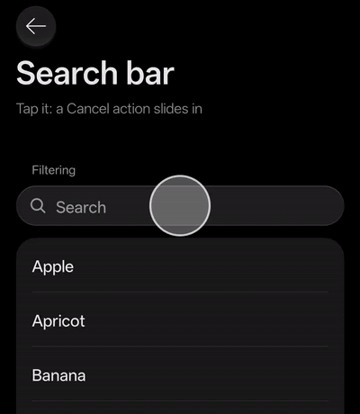</td>
<td valign="top" align="center"><a href="media/catalog/dark/SearchBar.png">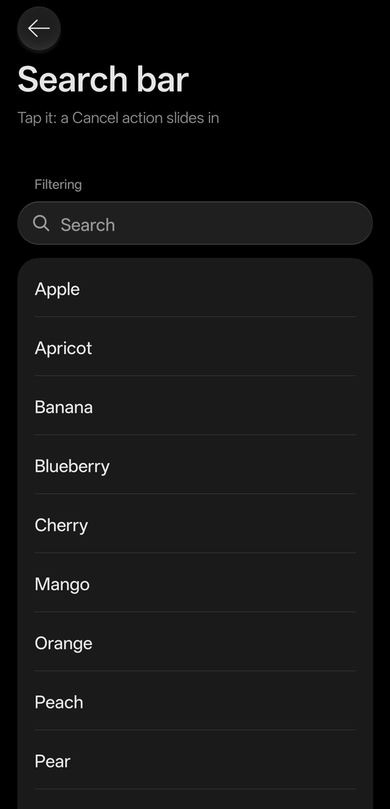</a><br><sub>dark</sub></td>
<td valign="top" align="center"><a href="media/catalog/light/SearchBar.png">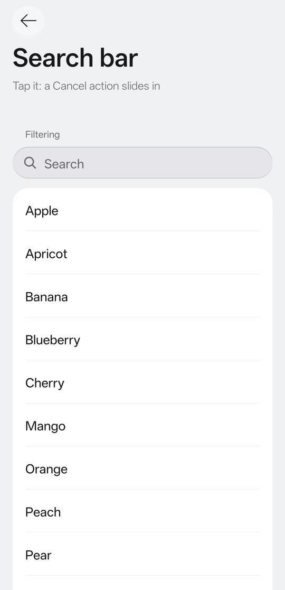</a><br><sub>light</sub></td>
</tr>
<tr>
<td valign="top" width="34%"><a id="checkbox"></a><b>Checkbox</b><br>Rounded square, the tick draws itself<br><sub>Uses <a href="api/iris-content.md#irisgroupedlist"><code>IrisGroupedList</code></a>, <a href="api/iris-content.md#irislistitem"><code>IrisListItem</code></a>, <a href="api/iris-inputs.md#irischeckbox"><code>IrisCheckbox</code></a></sub><br><sub><code>--es destination Checkbox</code> · <a href="../catalog/src/main/kotlin/dev/irisui/catalog/demos/InputsDemos.kt">source</a></sub><br>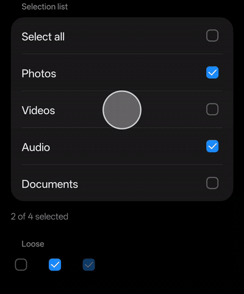</td>
<td valign="top" align="center"><a href="media/catalog/dark/Checkbox.png">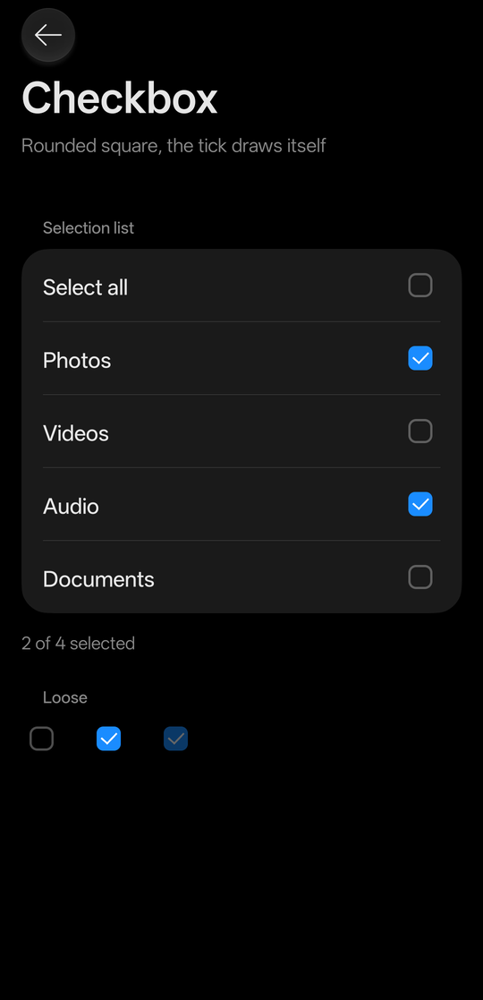</a><br><sub>dark</sub></td>
<td valign="top" align="center"><a href="media/catalog/light/Checkbox.png">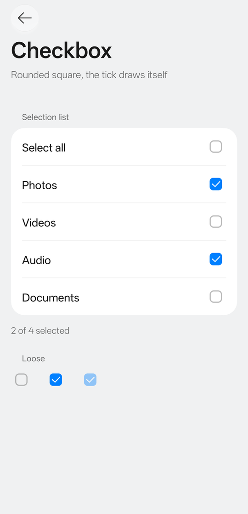</a><br><sub>light</sub></td>
</tr>
<tr>
<td valign="top" width="34%"><a id="slider"></a><b>Slider</b><br>Thick bar, a light follows the thumb while you hold it<br><sub>Uses <a href="api/iris-inputs.md#irisslider"><code>IrisSlider</code></a></sub><br><sub><code>--es destination Slider</code> · <a href="../catalog/src/main/kotlin/dev/irisui/catalog/demos/InputsDemos.kt">source</a></sub><br>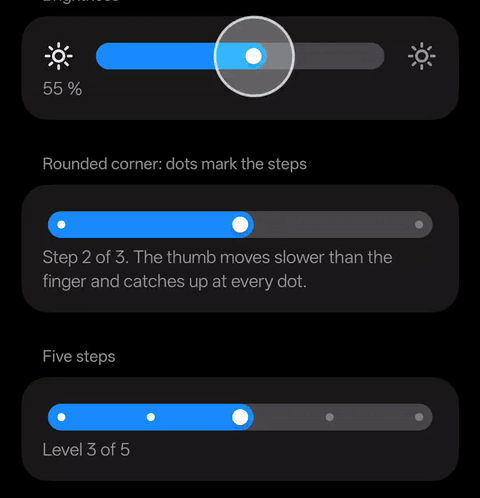</td>
<td valign="top" align="center"><a href="media/catalog/dark/Slider.png">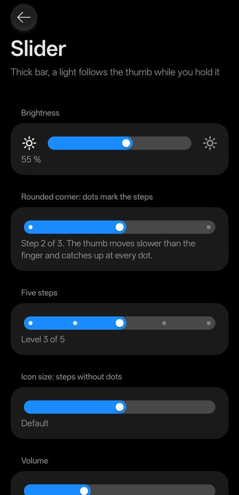</a><br><sub>dark</sub></td>
<td valign="top" align="center"><a href="media/catalog/light/Slider.png">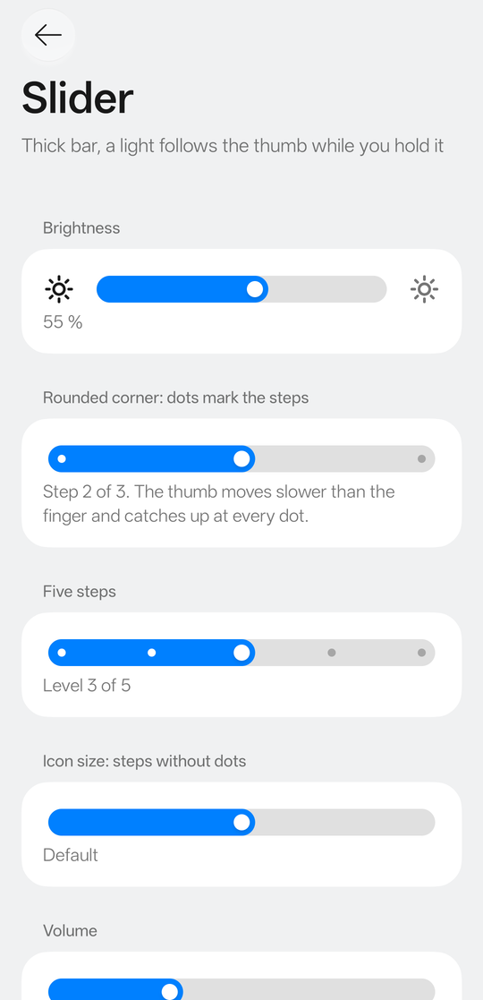</a><br><sub>light</sub></td>
</tr>
<tr>
<td valign="top" width="34%"><a id="progress"></a><b>Progress</b><br>Bar, ring and spinner of the stock apps<br><sub>Uses <a href="api/iris-inputs.md#irisprogressbar"><code>IrisProgressBar</code></a>, <a href="api/iris-inputs.md#irisslider"><code>IrisSlider</code></a>, <a href="api/iris-inputs.md#iriscircularprogress"><code>IrisCircularProgress</code></a>, <a href="api/iris-inputs.md#irisloadingspinner"><code>IrisLoadingSpinner</code></a></sub><br><sub><code>--es destination Progress</code> · <a href="../catalog/src/main/kotlin/dev/irisui/catalog/demos/InputsDemos.kt">source</a></sub><br>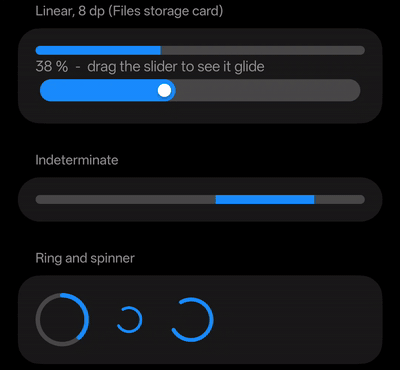</td>
<td valign="top" align="center"><a href="media/catalog/dark/Progress.png">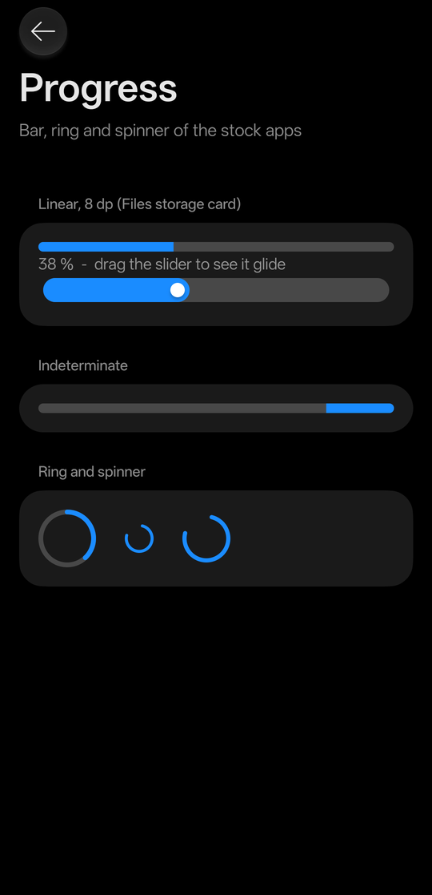</a><br><sub>dark</sub></td>
<td valign="top" align="center"><a href="media/catalog/light/Progress.png">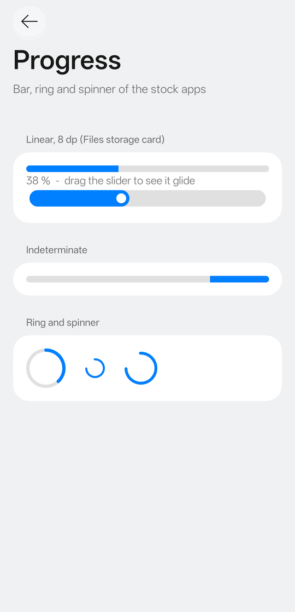</a><br><sub>light</sub></td>
</tr>
</table>

## Content

<table>
<tr>
<td valign="top" width="34%"><a id="card"></a><b>Card</b><br>Rounded surface with squircle corners<br><sub>Uses <a href="api/iris-content.md#iriscard"><code>IrisCard</code></a>, <a href="api/iris-content.md#irisicontile"><code>IrisIconTile</code></a></sub><br><sub><code>--es destination Card</code> · <a href="../catalog/src/main/kotlin/dev/irisui/catalog/demos/ContentDemos.kt">source</a></sub><br>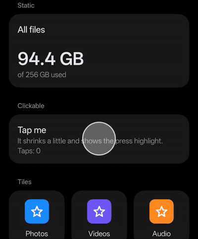</td>
<td valign="top" align="center"><a href="media/catalog/dark/Card.png">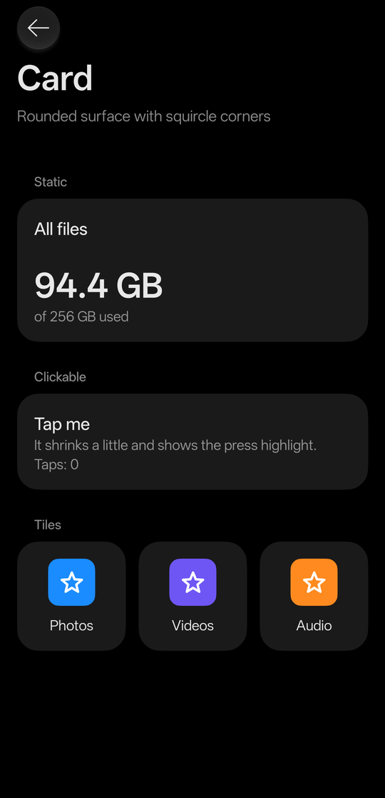</a><br><sub>dark</sub></td>
<td valign="top" align="center"><a href="media/catalog/light/Card.png"></a><br><sub>light</sub></td>
</tr>
<tr>
<td valign="top" width="34%"><a id="listitem"></a><b>List item</b><br>The row used across ColorOS Settings<br><sub>Uses <a href="api/iris-content.md#irisgroupedlist"><code>IrisGroupedList</code></a>, <a href="api/iris-content.md#irislistitem"><code>IrisListItem</code></a>, <a href="api/iris-content.md#irislisticon"><code>IrisListIcon</code></a>, <a href="api/iris-inputs.md#irisswitch"><code>IrisSwitch</code></a></sub><br><sub><code>--es destination ListItem</code> · <a href="../catalog/src/main/kotlin/dev/irisui/catalog/demos/ContentDemos.kt">source</a></sub><br></td>
<td valign="top" align="center"><a href="media/catalog/dark/ListItem.png"></a><br><sub>dark</sub></td>
<td valign="top" align="center"><a href="media/catalog/light/ListItem.png"></a><br><sub>light</sub></td>
</tr>
<tr>
<td valign="top" width="34%"><a id="groupedlist"></a><b>Grouped list</b><br>Rows share one card, dividers line up with the text<br><sub>Uses <a href="api/iris-content.md#irisgroupedlist"><code>IrisGroupedList</code></a>, <a href="api/iris-content.md#irislistitem"><code>IrisListItem</code></a>, <a href="api/iris-content.md#irislisticon"><code>IrisListIcon</code></a>, <a href="api/iris-inputs.md#irisswitch"><code>IrisSwitch</code></a></sub><br><sub><code>--es destination GroupedList</code> · <a href="../catalog/src/main/kotlin/dev/irisui/catalog/demos/ContentDemos.kt">source</a></sub><br></td>
<td valign="top" align="center"><a href="media/catalog/dark/GroupedList.png"></a><br><sub>dark</sub></td>
<td valign="top" align="center"><a href="media/catalog/light/GroupedList.png"></a><br><sub>light</sub></td>
</tr>
<tr>
<td valign="top" width="34%"><a id="sectionheader"></a><b>Section header</b><br>Small gray caption above a group<br><sub>Uses <a href="api/iris-content.md#irissectionheader"><code>IrisSectionHeader</code></a>, <a href="api/iris-content.md#irisgroupedlist"><code>IrisGroupedList</code></a>, <a href="api/iris-content.md#irislistitem"><code>IrisListItem</code></a>, <a href="api/iris-buttons.md#iristextbutton"><code>IrisTextButton</code></a></sub><br><sub><code>--es destination SectionHeader</code> · <a href="../catalog/src/main/kotlin/dev/irisui/catalog/demos/ContentDemos.kt">source</a></sub><br></td>
<td valign="top" align="center"><a href="media/catalog/dark/SectionHeader.png"></a><br><sub>dark</sub></td>
<td valign="top" align="center"><a href="media/catalog/light/SectionHeader.png"></a><br><sub>light</sub></td>
</tr>
<tr>
<td valign="top" width="34%"><a id="divider"></a><b>Divider</b><br>Hairline, optionally inset<br><sub>Uses <a href="api/iris-content.md#irisdivider"><code>IrisDivider</code></a></sub><br><sub><code>--es destination Divider</code> · <a href="../catalog/src/main/kotlin/dev/irisui/catalog/demos/ContentDemos.kt">source</a></sub><br></td>
<td valign="top" align="center"><a href="media/catalog/dark/Divider.png"></a><br><sub>dark</sub></td>
<td valign="top" align="center"><a href="media/catalog/light/Divider.png"></a><br><sub>light</sub></td>
</tr>
<tr>
<td valign="top" width="34%"><a id="badge"></a><b>Badge</b><br>Red dot and counts<br><sub>Uses <a href="api/iris-content.md#irisreddot"><code>IrisRedDot</code></a>, <a href="api/iris-content.md#irisbadge"><code>IrisBadge</code></a>, <a href="api/iris-content.md#irisicontile"><code>IrisIconTile</code></a></sub><br><sub><code>--es destination Badge</code> · <a href="../catalog/src/main/kotlin/dev/irisui/catalog/demos/ContentDemos.kt">source</a></sub><br></td>
<td valign="top" align="center"><a href="media/catalog/dark/Badge.png"></a><br><sub>dark</sub></td>
<td valign="top" align="center"><a href="media/catalog/light/Badge.png"></a><br><sub>light</sub></td>
</tr>
</table>

## Popups

<table>
<tr>
<td valign="top" width="34%"><a id="dialog"></a><b>Dialog</b><br>Docked glass card, dimmed page<br><sub>Uses <a href="api/iris-buttons.md#irisprimarybutton"><code>IrisPrimaryButton</code></a>, <a href="api/iris-buttons.md#irissecondarybutton"><code>IrisSecondaryButton</code></a>, <a href="api/iris-popups.md#irisdialog"><code>IrisDialog</code></a>, <a href="api/iris-inputs.md#irisunderlinetextfield"><code>IrisUnderlineTextField</code></a></sub><br><sub><code>--es destination Dialog</code> · <a href="../catalog/src/main/kotlin/dev/irisui/catalog/demos/PopupsDemos.kt">source</a></sub><br></td>
<td valign="top" align="center"><a href="media/catalog/dark/Dialog.png"></a><br><sub>dark</sub></td>
<td valign="top" align="center"><a href="media/catalog/light/Dialog.png"></a><br><sub>light</sub></td>
</tr>
<tr>
<td valign="top" width="34%"><a id="bottomsheet"></a><b>Bottom sheet</b><br>Drag it down: rubber band up, spring back<br><sub>Uses <a href="api/iris-buttons.md#irisprimarybutton"><code>IrisPrimaryButton</code></a>, <a href="api/iris-buttons.md#irissecondarybutton"><code>IrisSecondaryButton</code></a>, <a href="api/iris-popups.md#irisbottomsheet"><code>IrisBottomSheet</code></a>, <a href="api/iris-content.md#irisgroupedlist"><code>IrisGroupedList</code></a>, <a href="api/iris-content.md#irislistitem"><code>IrisListItem</code></a>, <a href="api/iris-inputs.md#irisswitch"><code>IrisSwitch</code></a>, <a href="api/iris-content.md#irislisticon"><code>IrisListIcon</code></a></sub><br><sub><code>--es destination BottomSheet</code> · <a href="../catalog/src/main/kotlin/dev/irisui/catalog/demos/PopupsDemos.kt">source</a></sub><br></td>
<td valign="top" align="center"><a href="media/catalog/dark/BottomSheet.png"></a><br><sub>dark</sub></td>
<td valign="top" align="center"><a href="media/catalog/light/BottomSheet.png"></a><br><sub>light</sub></td>
</tr>
<tr>
<td valign="top" width="34%"><a id="popupmenu"></a><b>Popup menu</b><br>Scales out of the corner nearest the anchor<br><sub>Uses <a href="api/iris-popups.md#irispopupmenubox"><code>IrisPopupMenuBox</code></a>, <a href="api/iris-popups.md#irismenuitem"><code>IrisMenuItem</code></a>, <a href="api/iris-popups.md#irismenudivider"><code>IrisMenuDivider</code></a>, <a href="api/iris-buttons.md#irissecondarybutton"><code>IrisSecondaryButton</code></a></sub><br><sub><code>--es destination PopupMenu</code> · <a href="../catalog/src/main/kotlin/dev/irisui/catalog/demos/PopupsDemos.kt">source</a></sub><br></td>
<td valign="top" align="center"><a href="media/catalog/dark/PopupMenu.png"></a><br><sub>dark</sub></td>
<td valign="top" align="center"><a href="media/catalog/light/PopupMenu.png"></a><br><sub>light</sub></td>
</tr>
</table>

## Effects

<table>
<tr>
<td valign="top" width="34%"><a id="blurlab"></a><b>Blur lab</b><br>Tune a glass material over any background and read its numbers<br><sub>Uses <a href="api/iris-effects.md#rememberbackdrop"><code>rememberBackdrop</code></a>, <a href="api/iris-effects.md#glassmaterial"><code>GlassMaterial</code></a>, <a href="api/iris-effects.md#glasslayer"><code>GlassLayer</code></a>, <a href="api/iris-effects.md#glassstyle"><code>GlassStyle</code></a>, <a href="api/iris-effects.md#glassdefaults"><code>GlassDefaults</code></a>, <a href="api/iris-effects.md#modifierbackdropsource"><code>Modifier.backdropSource</code></a>, <a href="api/iris-effects.md#modifierglass"><code>Modifier.glass</code></a>, <a href="api/iris-navigation.md#irisbottomnavpill"><code>IrisBottomNavPill</code></a>, <a href="api/iris-navigation.md#navitem"><code>NavItem</code></a>, <a href="api/iris-effects.md#progressiveblur"><code>ProgressiveBlur</code></a> and 10 more</sub><br><sub><code>--es destination BlurLab</code> · <a href="../catalog/src/main/kotlin/dev/irisui/catalog/demos/BlurLabDemo.kt">source</a></sub><br></td>
<td valign="top" align="center"><a href="media/catalog/dark/BlurLab.png"></a><br><sub>dark</sub></td>
<td valign="top" align="center"><a href="media/catalog/light/BlurLab.png"></a><br><sub>light</sub></td>
</tr>
<tr>
<td valign="top" width="34%"><a id="pressanimation"></a><b>Press animation</b><br>Everything shrinks while held, small and wide things the most<br><sub>Uses <a href="api/iris-effects.md#touchmotionmath"><code>TouchMotionMath</code></a>, <a href="api/iris-effects.md#modifiertouchmotion"><code>Modifier.touchMotion</code></a></sub><br><sub><code>--es destination PressAnimation</code> · <a href="../catalog/src/main/kotlin/dev/irisui/catalog/demos/EffectsDemos.kt">source</a></sub><br></td>
<td valign="top" align="center"><a href="media/catalog/dark/PressAnimation.png"></a><br><sub>dark</sub></td>
<td valign="top" align="center"><a href="media/catalog/light/PressAnimation.png"></a><br><sub>light</sub></td>
</tr>
<tr>
<td valign="top" width="34%"><a id="haptics"></a><b>Haptics</b><br>Feel every event on the device motor<br><sub>Uses <a href="api/iris-effects.md#localcoloroshaptics"><code>LocalColorOSHaptics</code></a>, <a href="api/iris-inputs.md#irisswitch"><code>IrisSwitch</code></a>, <a href="api/iris-navigation.md#irissegmentedtabs"><code>IrisSegmentedTabs</code></a>, <a href="api/iris-effects.md#hapticsource"><code>HapticSource</code></a>, <a href="api/iris-buttons.md#irissecondarybutton"><code>IrisSecondaryButton</code></a>, <a href="api/iris-effects.md#irishaptic"><code>IrisHaptic</code></a></sub><br><sub><code>--es destination Haptics</code> · <a href="../catalog/src/main/kotlin/dev/irisui/catalog/demos/EffectsDemos.kt">source</a></sub><br></td>
<td valign="top" align="center"><a href="media/catalog/dark/Haptics.png"></a><br><sub>dark</sub></td>
<td valign="top" align="center"><a href="media/catalog/light/Haptics.png"></a><br><sub>light</sub></td>
</tr>
<tr>
<td valign="top" width="34%"><a id="touchglow"></a><b>Touch glow</b><br>A light follows your finger and fades out<br><sub>Uses <a href="api/iris-effects.md#modifiertouchglow"><code>Modifier.touchGlow</code></a></sub><br><sub><code>--es destination TouchGlow</code> · <a href="../catalog/src/main/kotlin/dev/irisui/catalog/demos/EffectsDemos.kt">source</a></sub><br></td>
<td valign="top" align="center"><a href="media/catalog/dark/TouchGlow.png"></a><br><sub>dark</sub></td>
<td valign="top" align="center"><a href="media/catalog/light/TouchGlow.png"></a><br><sub>light</sub></td>
</tr>
<tr>
<td valign="top" width="34%"><a id="persistentglow"></a><b>Persistent glow</b><br>The light that always sits under a button<br><sub>Uses <a href="api/iris-effects.md#modifierpersistentglow"><code>Modifier.persistentGlow</code></a>, <a href="api/iris-core.md#irisicon"><code>IrisIcon</code></a>, <a href="api/iris-inputs.md#irisslider"><code>IrisSlider</code></a></sub><br><sub><code>--es destination PersistentGlow</code> · <a href="../catalog/src/main/kotlin/dev/irisui/catalog/demos/EffectsDemos.kt">source</a></sub><br></td>
<td valign="top" align="center"><a href="media/catalog/dark/PersistentGlow.png"></a><br><sub>dark</sub></td>
<td valign="top" align="center"><a href="media/catalog/light/PersistentGlow.png"></a><br><sub>light</sub></td>
</tr>
<tr>
<td valign="top" width="34%"><a id="dragphysics"></a><b>Drag physics</b><br>Hold and drag: elements stretch like rubber<br><sub>Uses <a href="api/iris-effects.md#touchmotionmath"><code>TouchMotionMath</code></a>, <a href="api/iris-effects.md#modifiertouchmotion"><code>Modifier.touchMotion</code></a>, <a href="api/iris-effects.md#modifierphysicsdrag"><code>Modifier.physicsDrag</code></a>, <a href="api/iris-effects.md#reorderablecolumn"><code>ReorderableColumn</code></a>, <a href="api/iris-core.md#irisicon"><code>IrisIcon</code></a></sub><br><sub><code>--es destination DragPhysics</code> · <a href="../catalog/src/main/kotlin/dev/irisui/catalog/demos/EffectsDemos.kt">source</a></sub><br><br></td>
<td valign="top" align="center"><a href="media/catalog/dark/DragPhysics.png"></a><br><sub>dark</sub></td>
<td valign="top" align="center"><a href="media/catalog/light/DragPhysics.png"></a><br><sub>light</sub></td>
</tr>
</table>

## Example screens

<table>
<tr>
<td valign="top" width="34%"><a id="preferencesexample"></a><b>Preferences</b><br>A settings page from grouped lists<br><sub>Uses <a href="api/iris-content.md#irissectionheader"><code>IrisSectionHeader</code></a>, <a href="api/iris-popups.md#irispopupmenubox"><code>IrisPopupMenuBox</code></a>, <a href="api/iris-popups.md#irismenuitem"><code>IrisMenuItem</code></a>, <a href="api/iris-content.md#irislistitem"><code>IrisListItem</code></a>, <a href="api/iris-inputs.md#irisslider"><code>IrisSlider</code></a>, <a href="api/iris-inputs.md#irisswitch"><code>IrisSwitch</code></a></sub><br><sub><code>--es destination PreferencesExample</code> · <a href="../catalog/src/main/kotlin/dev/irisui/catalog/demos/ExampleScreens.kt">source</a></sub></td>
<td valign="top" align="center"></td>
<td valign="top" align="center"></td>
</tr>
<tr>
<td valign="top" width="34%"><a id="habitsexample"></a><b>Habits</b><br>A tracker page: card with a progress ring, tabs, a checklist, a bottom pill and a sheet to add an item<br><sub>Uses <a href="api/iris-navigation.md#irislargetitlescaffold"><code>IrisLargeTitleScaffold</code></a>, <a href="api/iris-navigation.md#lazyliststatetitlescrolloffset"><code>LazyListState.titleScrollOffset</code></a>, <a href="api/iris-navigation.md#irisbackbutton"><code>IrisBackButton</code></a>, <a href="api/iris-navigation.md#irisbottomnavpill"><code>IrisBottomNavPill</code></a>, <a href="api/iris-navigation.md#navitem"><code>NavItem</code></a>, <a href="api/iris-buttons.md#irisroundplusbutton"><code>IrisRoundPlusButton</code></a>, <a href="api/iris-content.md#iriscard"><code>IrisCard</code></a>, <a href="api/iris-inputs.md#iriscircularprogress"><code>IrisCircularProgress</code></a>, <a href="api/iris-navigation.md#irissegmentedtabs"><code>IrisSegmentedTabs</code></a>, <a href="api/iris-content.md#irissectionheader"><code>IrisSectionHeader</code></a> and 11 more</sub><br><sub><code>--es destination HabitsExample</code> · <a href="../catalog/src/main/kotlin/dev/irisui/catalog/demos/ExampleScreens.kt">source</a></sub></td>
<td valign="top" align="center"></td>
<td valign="top" align="center"></td>
</tr>
<tr>
<td valign="top" width="34%"><a id="typescale"></a><b>Type scale</b><br>Every text style of the theme with its name, size and weight<br><sub>Uses <a href="api/iris-navigation.md#irisscaffold"><code>IrisScaffold</code></a>, <a href="api/iris-navigation.md#iristopbar"><code>IrisTopBar</code></a>, <a href="api/iris-navigation.md#irisbackbutton"><code>IrisBackButton</code></a></sub><br><sub><code>--es destination TypeScale</code> · <a href="../catalog/src/main/kotlin/dev/irisui/catalog/demos/ExampleScreens.kt">source</a></sub></td>
<td valign="top" align="center"></td>
<td valign="top" align="center"></td>
</tr>
</table>

