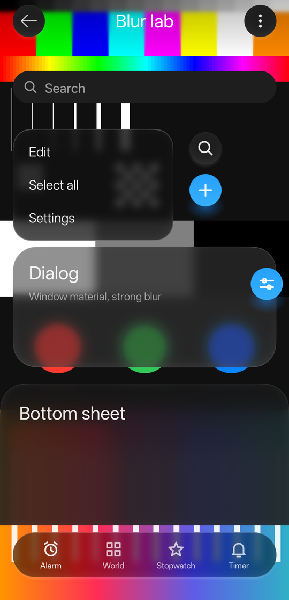

# Glass and blur

<table>
<tr>
<td align="center" valign="top"><br><sub>Blur lab</sub></td>
</tr>
</table>

The bottom pill, the toolbar buttons, popup menus, dialogs, bottom sheets and the search bar of ColorOS 17 are *glass*: the
page behind them is blurred and then passed through colored layers that keep its hue. The kit uses the same recipe, so a
surface of your own can look like them.

## The recipe

A `GlassMaterial` is the recipe ColorOS uses for every glass surface: the backdrop is blurred with a Gaussian (`blur`), then
passed through `layers`, each one a color blended with its own blend mode (Overlay and ColorDodge keep the colors of what is
behind the glass, Luminosity keeps its hue but takes the brightness of the color). There is no flat translucent tint.
`GlassMaterials` has the materials of ColorOS 17:

| Material | Level | Blur (sigma, px at 480 dpi) | Layers in the dark theme |
| --- | --- | --- | --- |
| `bottomBar` (the pill) | view | 25 | Overlay, Luminosity |
| `topBar` (toolbar buttons, top bar) | view | 20 | SrcOver, Overlay |
| `searchBar` | view | none | the layers of `topBar` |
| `popup` (menus) | window | 26.7 | Luminosity, Overlay |
| `dialog` | window | 33.3 | SrcOver, Overlay |
| `bottomSheet` | window | 66.7 | SrcOver, Overlay |

The object also has `secondaryButton`, `transparentButton`, `segmentButton` and `chipTab` for buttons on top of blurred
content. Blur values are pixels at 480 dpi in the system and are converted to dp here (3 px = 1 dp). *View level* materials
(bars, buttons) only see what is behind the view and mirror at its edges; *window level* materials (popup, dialog, sheet)
are blurred by the compositor, which also sees the content just outside the glass (`sampleOutside = true`). Every material
has a dark and a light variant (the light ones use ColorDodge instead of Overlay). The exact layers are in
[GlassMaterial.kt](../iris-effects/src/main/kotlin/dev/irisui/effects/GlassMaterial.kt).

## Putting glass on your own surface

Glass needs two things: the content to blur, marked as the *backdrop source*, and a surface drawn **above** it (a later
sibling, never inside the source) that is made glass.

```kotlin
val backdrop = rememberBackdrop()

Box(Modifier.fillMaxSize()) {
    // 1. The page. backdropSource records it (and still draws it normally). Give it an opaque background,
    //    otherwise the blurred copy is translucent and the sharp page shows through the glass.
    Box(
        Modifier
            .fillMaxSize()
            .backdropSource(backdrop)
            .background(IrisTheme.colors.background),
    ) { /* page content */ }

    // 2. The glass, drawn above the page.
    Box(
        Modifier
            .align(Alignment.BottomCenter)
            .padding(16.dp)
            .glass(IrisTheme.shapes.pill, GlassDefaults.bottomBar(), backdrop),
    ) { /* content of the surface */ }
}
```

You rarely have to do this yourself: `IrisApp` (through `IrisPopupHost`) and the scaffolds already create a backdrop,
mark the page as its source and provide it as `LocalBackdrop`, and `glass` uses `LocalBackdrop` when no backdrop is passed.
Everything the kit draws as glass picks it up automatically.

`GlassDefaults` has the styles (material plus rim light and edge glow) of the kit's surfaces:

| Style | For |
| --- | --- |
| `bottomBar()` | The floating bottom pill |
| `toolbarButton()` | Round glass buttons in toolbars (a fainter rim than the pill) |
| `popup()` | Popup menus |
| `dialog()` | Dialog panels |
| `bottomSheet()` | Bottom sheets (the strongest blur of the system) |
| `searchBar()` | The search bar |
| `surface(blur, tintAlpha)` | A floating surface with a flat tint, for custom layouts |
| `surface(material)` | Any glass surface built from a `GlassMaterial`, with the rim of the floating surfaces |

### A material of your own

```kotlin
val material = GlassMaterial(
    blur = (25f / 3f).dp,                                  // a sigma of 25 px at 480 dpi
    layers = listOf(
        GlassLayer(Color(0x40FFFFFF), BlendMode.Overlay),
        GlassLayer(Color(0x30000000), BlendMode.Luminosity),
    ),
)
Modifier.glass(IrisTheme.shapes.card, GlassDefaults.surface(material), backdrop)
```

`material.over(background)` tells you which color the material produces over a uniform opaque background, which is also what
is drawn when nothing can be blurred.

## Top bars: progressive blur

The blur under a top bar is not uniform: content that scrolls under the bar is blurred with a radius that falls linearly from
`maxBlur` at the top edge to nothing at the bottom edge, and covered by the page color with an alpha that falls the same way,
so content fades out instead of ending at a hard line. `ProgressiveBlur` draws it (stacked blurs of increasing radius,
`steps` = 5 by default), `Modifier.verticalFadeMask(GlassFade.TowardsBottom)` is the building block for your own. The
scaffolds put it behind the top bar for you.

## When nothing can be blurred

Real blur needs Android 12 (API 31, `RenderEffect`). Without a backdrop, or below API 31, `Modifier.glass` draws the material
as the flat color it has over `GlassStyle.fallbackBackdrop` (black by default; set it to the color of your page when it is not
black). The surface still looks like glass, it just does not show the page through.

## The Blur lab

The catalog screen **Effects > Blur lab** shows every glass surface on a background you choose, in dark or light, with the
stock materials or a custom one, and can draw one element at exact pixel coordinates over a screenshot of the real app. It is
the tool the materials were matched with; see [README: Blur lab](../README.md#blur-lab) for its extras.

## Reference

* [API reference of `iris-effects`](api/iris-effects.md): `Backdrop`, `GlassStyle`, `GlassMaterial`, `GlassMaterials`, `ProgressiveBlur`.
* [Catalog: Effects](catalog.md#effects)
