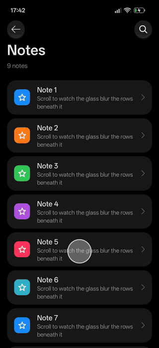
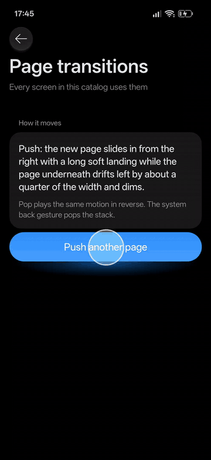
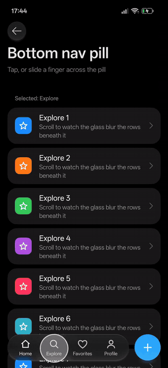
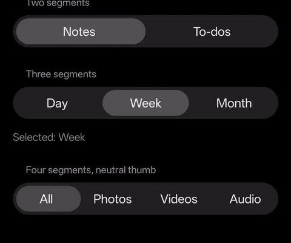

# Navigation

<table>
<tr>
<td align="center" valign="top"><br><sub>Large title</sub></td>
<td align="center" valign="top"><br><sub>Push and back swipe</sub></td>
<td align="center" valign="top"><br><sub>Bottom pill</sub></td>
</tr>
</table>

The navigation module (`iris-navigation`) has the chrome of a ColorOS page, the controls that switch between content, and
the container that moves between pages.

## Page scaffolds

Both scaffolds let the content fill the whole screen: it scrolls under a progressive blur at the top and under a floating
glass pill and round button at the bottom, and everything in the slots that uses glass blurs the page through
`LocalBackdrop` ([Glass and blur](glass-and-blur.md)). The content lambda receives padding that already accounts for the
bars: use it as `contentPadding` of the list.

### Compact top bar: `IrisScaffold`

```kotlin
val listState = rememberLazyListState()
IrisScaffold(
    topBar = {
        IrisTopBar(
            title = "Top bar",
            navigationIcon = { IrisBackButton(onBack) },
            actions = { IrisIconButton(IrisIcons.Search, onClick = { }, contentDescription = "Search") },
        )
    },
    topBlurAlpha = { (listState.titleScrollOffset()() / 24f).coerceIn(0f, 1f) },   // blur fades in as content passes under the bar
) { padding ->
    LazyColumn(Modifier.fillMaxSize(), state = listState, contentPadding = padding) { /* items */ }
}
```

`IrisTopBar` is transparent on purpose (the scaffold puts the blur behind it): a round back button, a title next to it and
round action buttons. `titleAlpha` is read while drawing, so it can follow scrolling without recomposition. Its height is
`IrisTopBarDefaults.Height` (52 dp below the status bar).

### Collapsing large title: `IrisLargeTitleScaffold`

Place `LargeTitle()` as the first item of the scrolling content and hand over how far the content is scrolled. The small title
fades into the top bar once the large one has scrolled away, and the blur under the bar fades in as soon as content passes
below it.

```kotlin
val listState = rememberLazyListState()
IrisLargeTitleScaffold(
    title = "Notes",
    subtitle = "9 notes",
    scrollOffset = listState.titleScrollOffset(),
    navigationIcon = { IrisBackButton(onBack) },
    actions = { IrisIconButton(IrisIcons.Search, onClick = { }, contentDescription = "Search") },
) { padding ->
    LazyColumn(Modifier.fillMaxSize(), state = listState, contentPadding = padding) {
        item { LargeTitle() }          // 32 sp, with the optional 14 sp subtitle
        /* items */
    }
}
```

`LazyListState.titleScrollOffset()` is the offset for a lazy list; for other scrolling content pass your own lambda that
returns the scrolled distance in px. The title and the subtitle can be dragged like the other Liquid Glass elements
([Touch](touch-and-drag.md#which-elements-drag)).

### Bottom pill and plus button

Both scaffolds take a `bottomBar` and a `floatingActionButton`. `fabAbovePill = true` centers the round button above the pill
(the Clock style) instead of beside it (the Notes style).

```kotlin
var selected by remember { mutableIntStateOf(0) }
val items = listOf(
    NavItem("Home", IrisIcons.Home, IrisIcons.HomeFilled),     // the filled icon is shown while selected
    NavItem("Explore", IrisIcons.Search),
    NavItem("Favorites", IrisIcons.Heart, IrisIcons.HeartFilled),
    NavItem("Profile", IrisIcons.Person, IrisIcons.PersonFilled),
)
IrisScaffold(
    bottomBar = { IrisBottomNavPill(items, selected, { selected = it }) },
    floatingActionButton = { IrisRoundPlusButton(onClick = { }) },
) { padding -> /* content */ }
```

`IrisBottomNavPill` is the floating glass pill: tap or slide a finger across it to switch tabs. The pill shrinks while
touched and follows the finger with rubber-band resistance, a soft light follows the finger, and there is no capsule behind
the selected tab: it just switches to its filled icon and full-strength tint, like the Clock and Files pills.

## Segmented tabs and chips

```kotlin
IrisSegmentedTabs(listOf("Day", "Week", "Month"), selectedIndex, { selectedIndex = it })
```

A 40 dp track with a neutral 32 dp thumb. Tap a segment or slide the thumb; the two edges of the thumb are springs of their own,
so it stretches by about 10 % on the way, and the whole control shrinks to 96 % while it is held. A selection change is silent.
Colors can be passed (`trackColor`, `thumbColor`, `selectedContentColor`, `unselectedContentColor`).

`IrisChip(text, selected, onClick)` is a chip of a single choice row (32 dp high pill, the selected one accent filled) and
`IrisChipRow { ... }` a horizontally scrolling row of them, 20 dp from the screen edge, whose end fades out when more chips
are hidden behind the edge.



## Pages: push, pop and the stack

`PageStack` is a minimal back stack; pages can be any value (an enum, a sealed class, ...). `IrisPageHost` shows its pages
with the ColorOS transition and handles the back gesture:

```kotlin
sealed interface Screen {
    data object Home : Screen
    data class Detail(val id: Int) : Screen
}

IrisApp {
    val stack = rememberPageStack<Screen>(Screen.Home)
    IrisPageHost(stack) { screen ->
        when (screen) {                                         // push(...) opens a page, pop() or the back gesture closes it
            Screen.Home -> Home(onOpen = { stack.push(Screen.Detail(it)) })
            is Screen.Detail -> Detail(screen.id, onBack = { stack.pop() })
        }
    }
}
```

| | |
| --- | --- |
| Push | The new page slides in from the right on a spring (damping 0.8, response 0.33 s) while the page below drifts 30 % of the width to the left and is darkened by a scrim that ramps up to 50 % within 185 ms |
| Pop | The same motion backwards on a critically damped spring (response 0.35 s) |
| State | Pages below the top one leave the composition, but their `rememberSaveable` state (scroll positions, text of fields) survives while they are covered |
| System back | The back button and the back gesture pop the stack |

`stack.current`, `stack.depth`, `stack.canPop` and `stack.lastAction` (`PageAction.Push` or `Pop`) describe the state.
`rememberPageStack` is a plain `remember`: when your activity can be recreated (rotation, theme or font change) keep the
stack alive with `android:configChanges`, as the catalog does, or rebuild it from your own saved state.

## The back swipe

With `IrisPageHost` the page follows the finger 1:1 during the edge back swipe, is clipped to the rounded display corners,
and the page below drifts a quarter of the width with a scrim that fades out with the distance. Releasing past the system
threshold (45 dp on ColorOS) slides the page out, releasing earlier springs it back. The page always moves from left to right,
also when the swipe starts at the right edge (the distance from that edge counts).

On the OnePlus 15 (ColorOS 17) the system only reports the finger position to a single-activity app when the window is one
pixel wider than the display; `IrisPageHost` does that by itself (`trackBackGesture = true`, nothing changes in layout, and
nothing happens before Android 16 or in multi-window mode). **Nothing goes into your manifest**: the manifest of the library
brings `android:enableOnBackInvokedCallback="true"`, which the system needs before it sends the animation any progress. If your
app sets that attribute to `false` itself, add `tools:replace="android:enableOnBackInvokedCallback"`.

With your own navigation instead of `PageStack`, call `IrisBackGestureTracking()` once near the root of the content and use
`PredictiveBackHandler` as usual: `BackEventCompat.touchX` is the real finger position then, and
`event.travelFromEdge(widthPx)` gives the distance from the edge the swipe started at:

```kotlin
IrisBackGestureTracking()
PredictiveBackHandler(enabled = canGoBack) { events ->
    events.collect { event -> pageOffset = event.travelFromEdge(widthPx) }
    goBack()
}
```

Why this is needed and how it was found out is written up in the documentation of
[`IrisBackGestureTracking`](api/iris-navigation.md#irisbackgesturetracking) and in the
[README](../README.md#back-swipe-and-the-system).

## Reference

* [API reference of `iris-navigation`](api/iris-navigation.md)
* [Catalog: Navigation](catalog.md#navigation)
