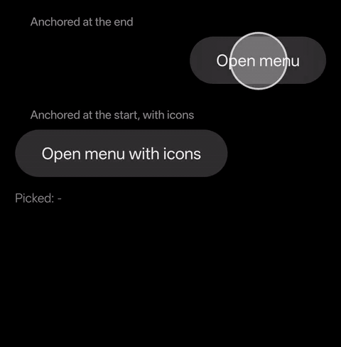
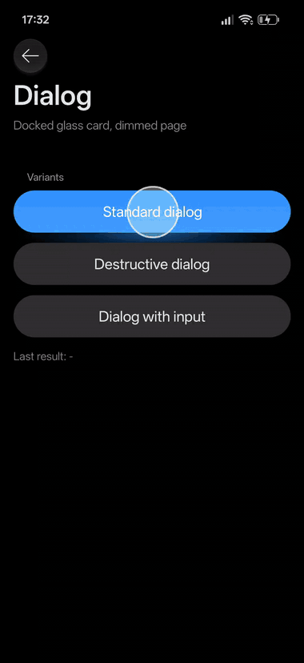
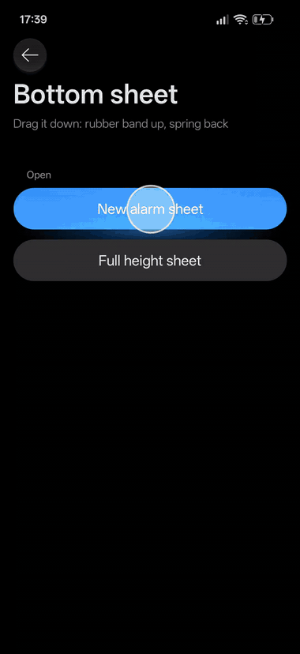

# Popups

<table>
<tr>
<td align="center" valign="top"><br><sub>Popup menu</sub></td>
<td align="center" valign="top"><br><sub>Dialog</sub></td>
<td align="center" valign="top"><br><sub>Bottom sheet</sub></td>
</tr>
</table>

The popups module (`iris-popups`) has the three popups of ColorOS: the popup menu, the dialog and the bottom sheet. All of
them are made of [glass](glass-and-blur.md) with the material the system uses for that kind of window, dim or blur the page
behind them, and animate in and out on the springs measured on the phone.

## They need a host

Popups are not separate Android windows. They register with a popup host that draws them in a layer above the page, so every
popup can blur the page through the same backdrop. `IrisApp` has that host built in; use `IrisPopupHost` when you only
want the popups:

```kotlin
IrisPopupHost { /* the whole app, or one screen */ }
```

Without a host a popup is composed in place, inside the composable that calls it, instead of above the page.

Every popup is driven by state: you keep a `Boolean` and the popup animates when it changes. `onDismissRequest` is called when
the user taps the dimmed page, presses back or (sheets) drags the sheet away; set your state to `false` there.

## Dialog

`IrisDialog` is the confirmation dialog. It docks near the bottom of the screen like on ColorOS: a dimmed page, a rounded
glass card, a centered title and two pill buttons side by side.

```kotlin
var show by remember { mutableStateOf(false) }

IrisDialog(
    visible = show,
    onDismissRequest = { show = false },
    title = "Allow notifications?",
    message = "The app can send you alerts about new activity. You can change this later in Settings.",
    confirmText = "Allow",
    onConfirm = { show = false /* ... */ },
    dismissText = "Not now",          // "Cancel" by default, null for a single button
)
```

| Parameter | |
| --- | --- |
| `destructive` | The confirm button turns red (a delete dialog) |
| `confirmEnabled` | Greys the confirm button out, for example while a text field is still empty |
| `content` | Extra content below the message, for example `IrisUnderlineTextField(...)` (the "Change device name" dialog of Settings) |

`IrisDialogContainer` is the dialog shell without any content, for fully custom dialogs; the card rides above the
navigation bar and the keyboard.

The window of a dialog has no drag physics, only its buttons do ([Touch](touch-and-drag.md#which-elements-drag)).

## Bottom sheet

`IrisBottomSheet` slides up from the bottom and dims the page behind it. It can be dragged down to dismiss:

```kotlin
var show by remember { mutableStateOf(false) }

IrisBottomSheet(visible = show, onDismissRequest = { show = false }) {
    // a ColumnScope: header, lists, buttons ...
    Row(Modifier.fillMaxWidth().padding(16.dp), horizontalArrangement = Arrangement.SpaceBetween) {
        IrisSecondaryButton("Cancel", { show = false })
        IrisText("New alarm", style = IrisTheme.typography.headline)
        IrisSecondaryButton("Done", { show = false })
    }
    /* rows ... */
}
```

| Parameter | |
| --- | --- |
| `fullHeight` | The sheet fills the height below the status bar (default: as high as its content) |
| `showHandle` | Draws the small grab handle at the top |

The drag behaves like the sheets of the Clock app: pulled upwards it resists like rubber, pulled downwards it follows the
finger, and on release it only dismisses by *position* (when more than half of its height is out; before that it springs
back, however fast the fling was). The page behind brightens as the sheet leaves.

## Popup menu

`IrisPopupMenuBox` anchors a menu to any composable. The menu opens as a blurred glass card that pops out of a point near
the anchor (79 % across and 33 % down the panel), the way the "more" menus of ColorOS apps do, and closes the same way,
faster:

```kotlin
var open by remember { mutableStateOf(false) }

IrisPopupMenuBox(
    expanded = open,
    onDismissRequest = { open = false },
    menu = {
        IrisMenuItem("Edit", onClick = { })
        IrisMenuItem("Grid view", onClick = { })
        IrisMenuDivider()
        IrisMenuItem("Sort by time edited", onClick = { }, checked = true)
        IrisMenuItem("Delete", onClick = { }, icon = IrisIcons.Trash, destructive = true)
    },
) {
    IrisIconButton(IrisIcons.More, onClick = { open = true }, contentDescription = "More")   // the anchor
}
```

* `IrisMenuItem` is one 40 dp row (`icon`, `checked` and `destructive` are optional) and closes the menu after `onClick`.
  Pressing, sliding the finger over the rows and selecting is handled by the panel itself, so rows have no touch feedback of
  their own.
* `IrisMenuDivider` is the 12 dp gap between groups of rows.
* `centerOnScreen = true` is for a menu opened from a full-width list row (a dropdown preference): the panel is centered on the
  screen and its top edge sits at the vertical center of the row.

## Reference

* [API reference of `iris-popups`](api/iris-popups.md)
* [Catalog: Popups](catalog.md#popups)
