# Recordings

Every screen of the catalog in motion, recorded on a OnePlus 15 in the dark theme. The grey circle under the finger is drawn by the catalog app (`--ez touches true`), the system "show touches" setting was left alone; the edge swipe of the back gesture belongs to the system, so it shows no circle. Click a title for the screen with its screenshots and the kit APIs it uses.

This page is generated by `tools/docs/DocGen.java`; the recordings are made with `tools/gif.sh`.

## Navigation

<table>
<tr>
<td align="center" valign="top">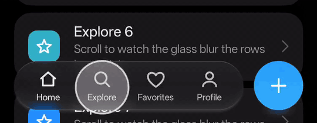 <a href="catalog.md#bottomnavpill"><b>Bottom nav pill: close-up</b></a></td>
<td align="center" valign="top">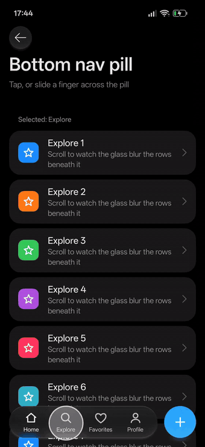 <a href="catalog.md#bottomnavpill"><b>Bottom nav pill: whole screen</b></a></td>
<td align="center" valign="top">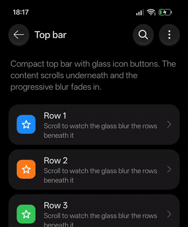 <a href="catalog.md#topbar"><b>Top bar</b></a></td>
<td align="center" valign="top">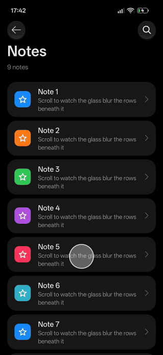 <a href="catalog.md#largetitle"><b>Collapsing large title</b></a></td>
</tr>
<tr>
<td align="center" valign="top">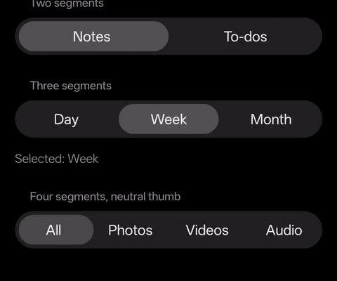 <a href="catalog.md#segmentedtabs"><b>Segmented tabs</b></a></td>
<td align="center" valign="top">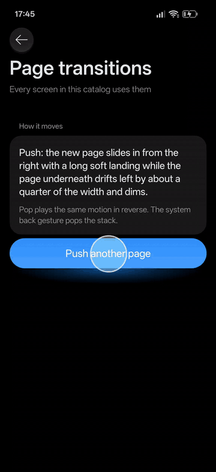 <a href="catalog.md#pagetransitions"><b>Page transitions</b></a></td>
</tr>
</table>

## Buttons

<table>
<tr>
<td align="center" valign="top">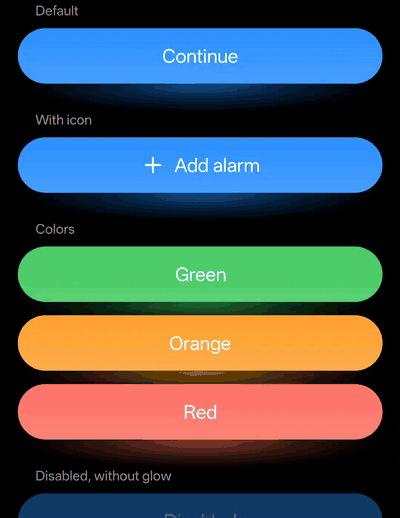 <a href="catalog.md#primarybutton"><b>Primary button</b></a></td>
<td align="center" valign="top">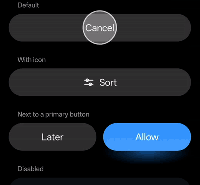 <a href="catalog.md#secondarybutton"><b>Secondary button</b></a></td>
<td align="center" valign="top">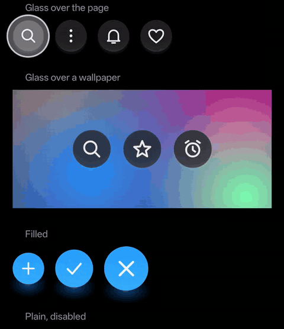 <a href="catalog.md#iconbutton"><b>Icon button</b></a></td>
<td align="center" valign="top">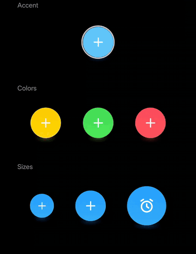 <a href="catalog.md#roundplusbutton"><b>Round plus button</b></a></td>
</tr>
<tr>
<td align="center" valign="top">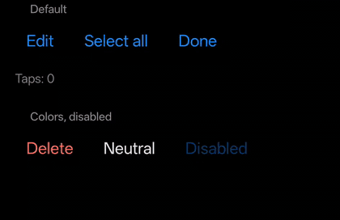 <a href="catalog.md#textbutton"><b>Text button</b></a></td>
</tr>
</table>

## Inputs

<table>
<tr>
<td align="center" valign="top">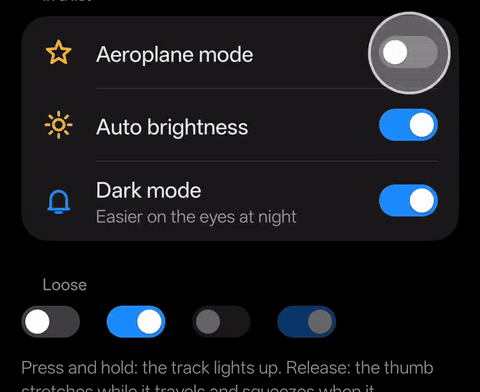 <a href="catalog.md#switch"><b>Switch</b></a></td>
<td align="center" valign="top">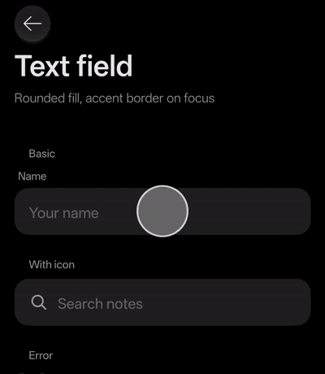 <a href="catalog.md#textfield"><b>Text field</b></a></td>
<td align="center" valign="top">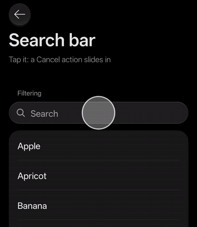 <a href="catalog.md#searchbar"><b>Search bar</b></a></td>
<td align="center" valign="top">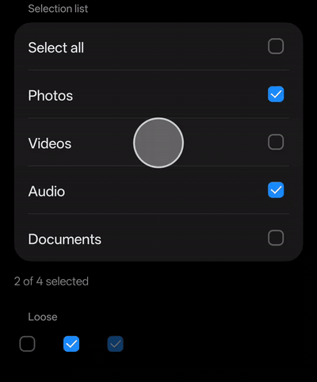 <a href="catalog.md#checkbox"><b>Checkbox</b></a></td>
</tr>
<tr>
<td align="center" valign="top">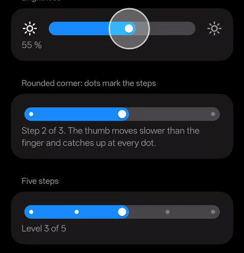 <a href="catalog.md#slider"><b>Slider</b></a></td>
<td align="center" valign="top">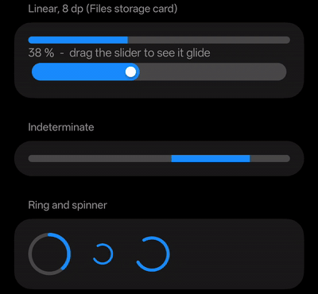 <a href="catalog.md#progress"><b>Progress</b></a></td>
</tr>
</table>

## Content

<table>
<tr>
<td align="center" valign="top">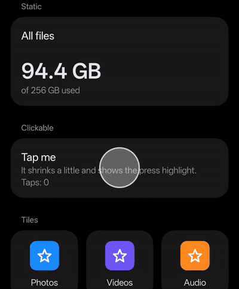 <a href="catalog.md#card"><b>Card</b></a></td>
<td align="center" valign="top">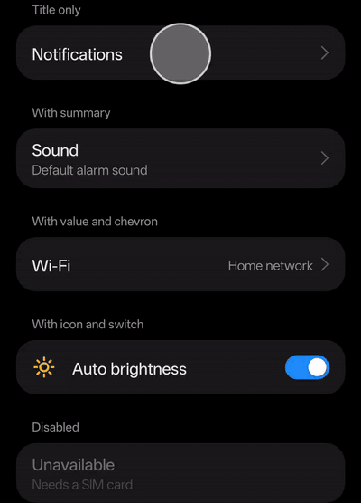 <a href="catalog.md#listitem"><b>List item</b></a></td>
<td align="center" valign="top">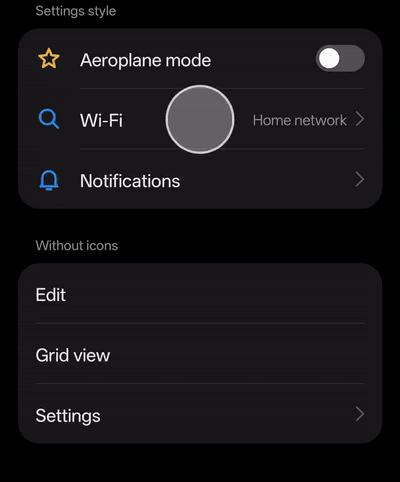 <a href="catalog.md#groupedlist"><b>Grouped list</b></a></td>
<td align="center" valign="top">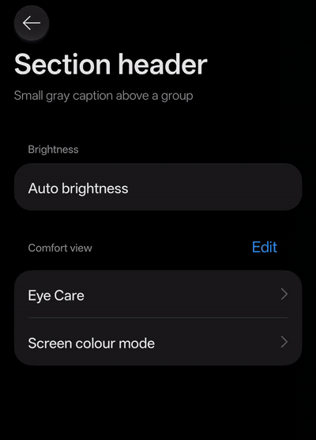 <a href="catalog.md#sectionheader"><b>Section header</b></a></td>
</tr>
<tr>
<td align="center" valign="top">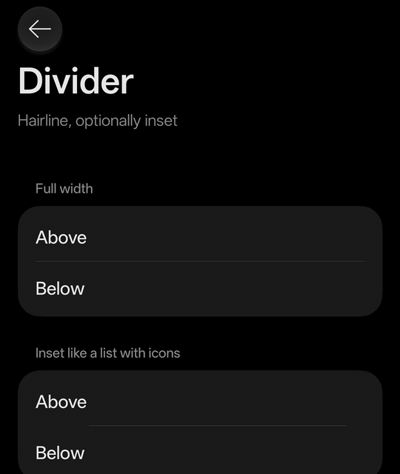 <a href="catalog.md#divider"><b>Divider: dark and light</b></a></td>
<td align="center" valign="top">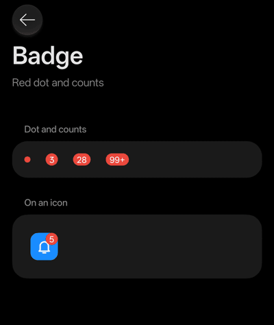 <a href="catalog.md#badge"><b>Badge: dark and light</b></a></td>
</tr>
</table>

## Popups

<table>
<tr>
<td align="center" valign="top"> <a href="catalog.md#dialog"><b>Dialog</b></a></td>
<td align="center" valign="top"> <a href="catalog.md#bottomsheet"><b>Bottom sheet</b></a></td>
<td align="center" valign="top">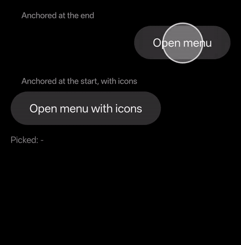 <a href="catalog.md#popupmenu"><b>Popup menu</b></a></td>
</tr>
</table>

## Effects

<table>
<tr>
<td align="center" valign="top">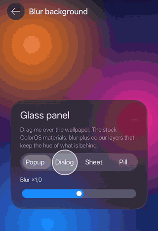 <a href="catalog.md#blurbackground"><b>Blur background</b></a></td>
<td align="center" valign="top">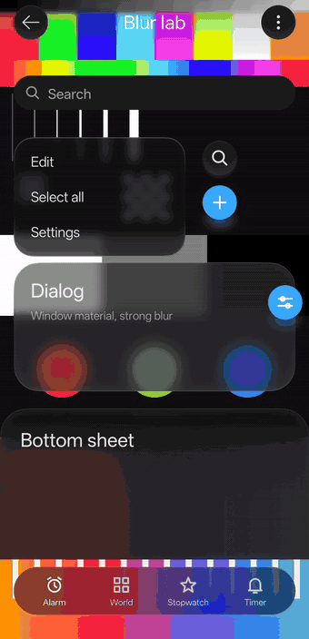 <a href="catalog.md#blurlab"><b>Blur lab</b></a></td>
<td align="center" valign="top">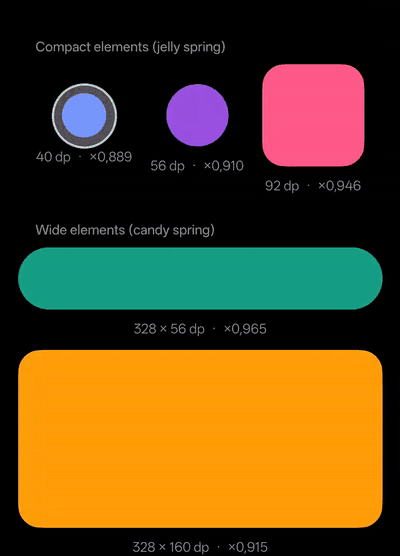 <a href="catalog.md#pressanimation"><b>Press animation</b></a></td>
<td align="center" valign="top">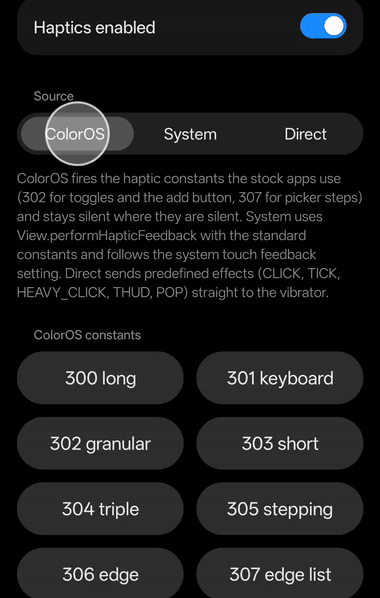 <a href="catalog.md#haptics"><b>Haptics</b></a></td>
</tr>
<tr>
<td align="center" valign="top">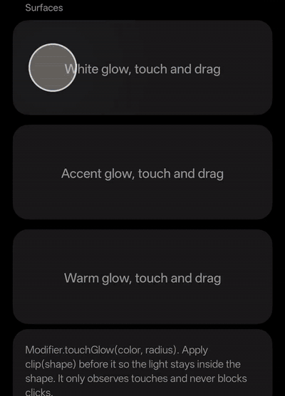 <a href="catalog.md#touchglow"><b>Touch glow</b></a></td>
<td align="center" valign="top">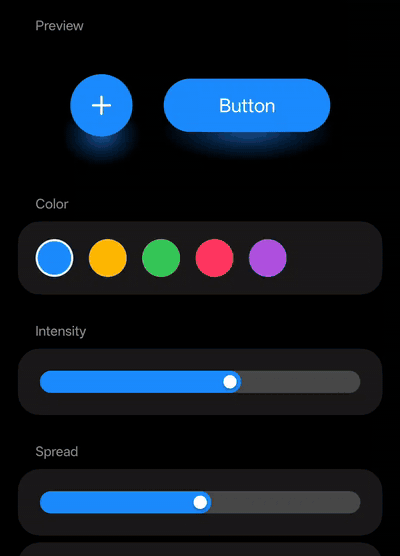 <a href="catalog.md#persistentglow"><b>Persistent glow</b></a></td>
<td align="center" valign="top">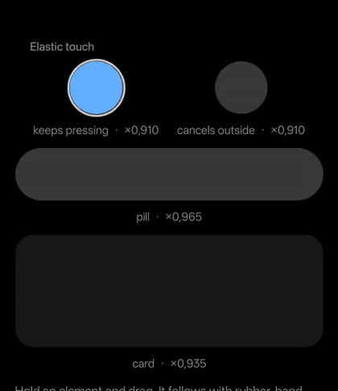 <a href="catalog.md#dragphysics"><b>Drag physics</b></a></td>
<td align="center" valign="top">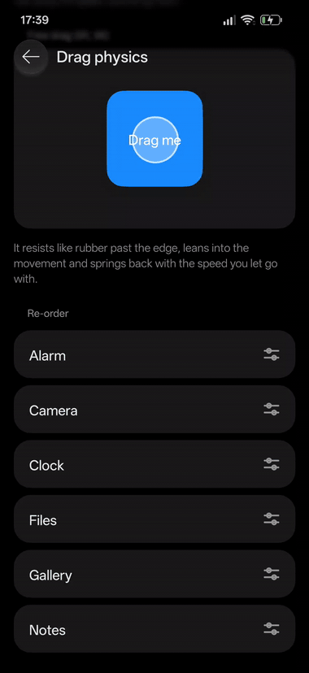 <a href="catalog.md#dragphysics"><b>Drag physics: free drag and re-order</b></a></td>
</tr>
</table>

## More

<table>
<tr>
<td align="center" valign="top">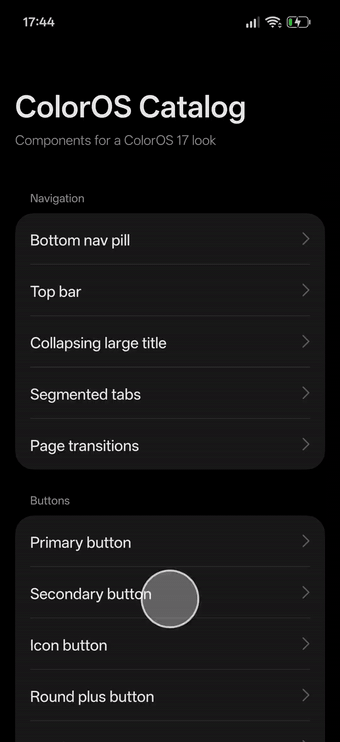 <b>Home screen: scroll and bounce</b></td>
</tr>
</table>

