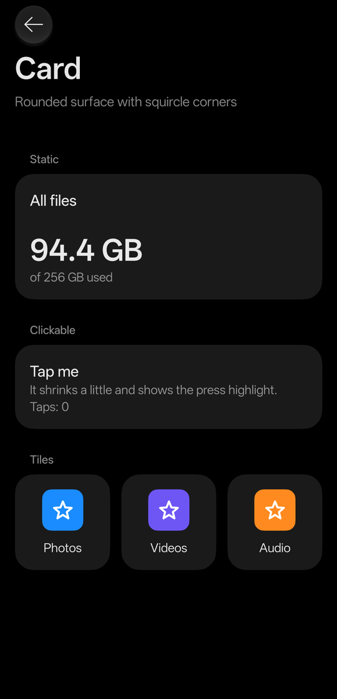
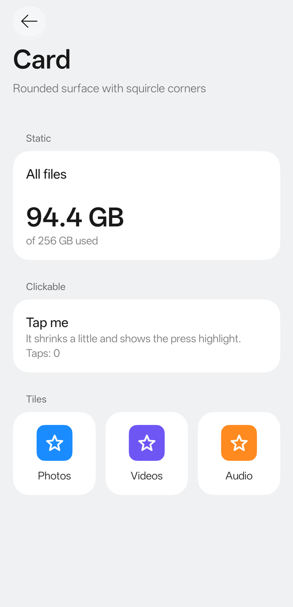
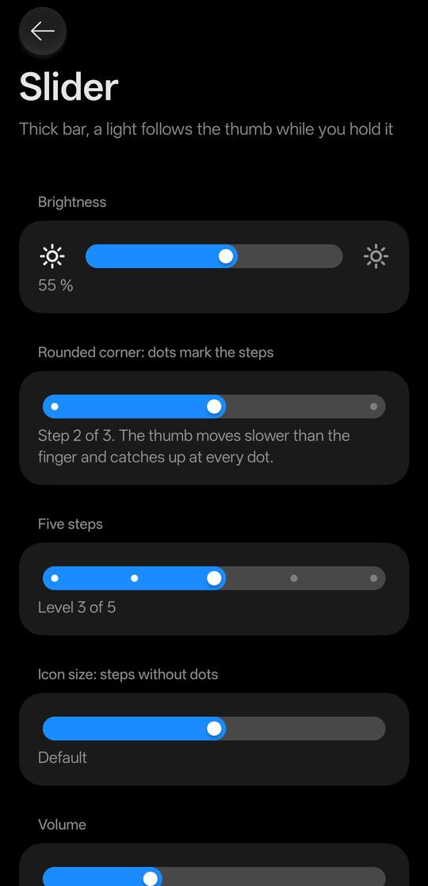
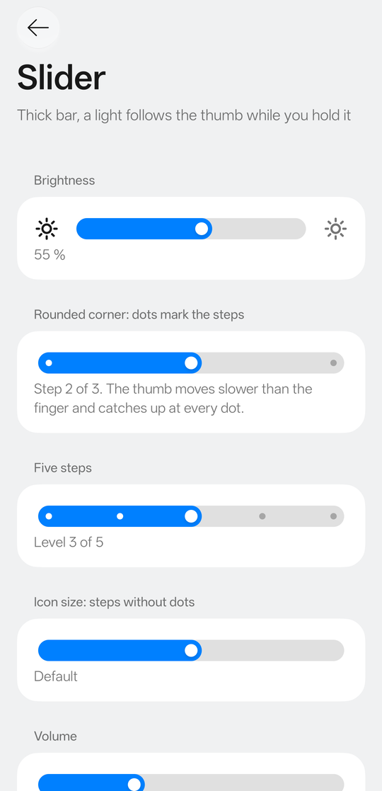

# Theming

<table>
<tr>
<td align="center"><br><sub>dark</sub></td>
<td align="center"><br><sub>light</sub></td>
<td align="center"><br><sub>dark</sub></td>
<td align="center"><br><sub>light</sub></td>
</tr>
</table>

Everything the components draw comes from four token sets, read through `IrisTheme`:

```kotlin
val colors = IrisTheme.colors          // IrisColors
val type = IrisTheme.typography        // IrisTypography
val shapes = IrisTheme.shapes          // IrisShapes
val motion = IrisTheme.motion          // IrisMotion
```

They are provided by `IrisApp` (theme plus haptics, popup layer and overscroll) or, when you only want the theme, by
`IrisTheme { ... }`:

```kotlin
IrisTheme(darkTheme = isSystemInDarkTheme()) { /* content */ }
```

Outside any theme the tokens fall back to the dark palette and the default typography, shapes and motion. The measured
values behind the tokens are in the [README](../README.md#design-tokens-measured-on-the-device).

## Dark and light

`darkTheme` selects `irisDarkColors()` or `irisLightColors()`. `IrisApp` also sets the color of the status bar
and navigation bar icons, so the clock and the battery stay readable when the theme differs from the system
(the catalog's `--ez light true` does exactly that on a dark phone).

## Colors

`IrisColors` holds one value per role. The values match ColorOS 17. Most text and
surface colors are translucent white (dark) or black (light) on purpose, so they blend with what is behind them.

| Role | Tokens |
| --- | --- |
| Page and surfaces | `background`, `surface` (cards and grouped lists on the page), `surfaceElevated` (cards on a sheet or dialog), `surfaceVariant` (chips, secondary buttons, segmented track, round icon buttons), `field` (text fields, search bar) |
| Glass | `glass` (tint of the bottom pill, popup menu and top bar), `sheet`, `dialog`, `rimHighlight`, `rimShade` |
| Text and icons | `content` (primary), `contentSecondary`, `contentTertiary` (hints, disabled), `contentVariant`, `contentSecondaryVariant`, `contentQuaternary` |
| Accent | `accent`, `onAccent`, `accentText` (text buttons and links, lighter than `accent` in the dark theme), `destructive`, `destructiveContainer` |
| Controls | `switchTrackOff`, `trackEmpty` (empty part of sliders and progress bars), `divider` |
| Interaction | `pressOverlay` (flat highlight of a pressed row), `anchorHighlight` (the row a popup menu belongs to), `scrim` |
| Mode | `isDark` |

Read them where you draw:

```kotlin
Box(Modifier.background(IrisTheme.colors.surface))
IrisText("Summary", color = IrisTheme.colors.contentSecondary)
```

`IrisText` and `IrisIcon` take their color from `LocalContentColor`, which the theme sets to `colors.content`.

### Changing colors

`IrisColors` is a plain class with a constructor, not a data class. To change a token, make your own instance (the
functions `irisDarkColors()` and `irisLightColors()` in
[IrisColors.kt](../iris-core/src/main/kotlin/dev/irisui/core/IrisColors.kt) are the templates to copy) and pass it in:

```kotlin
IrisApp(colors = myColors) { /* content */ }
```

The components that have a color of their own take it as a parameter, which is the lighter way to change a single accent:

```kotlin
IrisPrimaryButton("Save", onClick = { }, color = Color(0xFF428AF7))   // the blue of the Settings app
```

## Text styles

`IrisTypography` follows the type scale of ColorOS 17. Line heights are the measured line boxes of the real apps, and
the weights are the weights the system font is *drawn at* (it is a variable font): titles around 575, summaries 400. The kit
does not bundle a font, text uses the system font (see the [FAQ](faq.md#why-does-my-text-look-different-from-the-screenshots)).

| Style | Size | Where it is used |
| --- | --- | --- |
| `largeTitleXL` | 40 sp, weight 850 | Large title of top level pages such as the Settings home page |
| `largeTitle` | 32 sp, weight 850 | Collapsing large title of in-app pages |
| `numeric` | 30 sp, weight 580 | Clock style digits |
| `title` | 22 sp, medium | Dialog and sheet titles |
| `dialogTitle`, `topBarTitle` | 18 sp, weight 700 / 708 | Titles of dialogs and of the compact top bar |
| `headline`, `body` | 16 sp, weight 575 | Row titles, headlines |
| `subtitle` | 16 sp | Secondary lines |
| `button` | 17 sp, medium | Buttons |
| `label` | 15 sp, medium | Labels |
| `menuItem` | 15 sp | Rows of popup menus |
| `chip` | 14 sp, weight 500 | Chip labels |
| `subtitleSmall` | 14 sp | Line under a large title |
| `bodySmall` | 13 sp | Dialog message, row summary |
| `sectionHeader` | 12 sp, weight 575 | Group header above cards |
| `caption` | 12 sp | Small secondary text |
| `tabLabel` | 10 sp, weight 500 | Labels of the bottom pill |

```kotlin
IrisText("Alarm", style = IrisTheme.typography.headline)
```

## Shapes

Corners are *squircles*: `SmoothRoundedCornerShape` draws the continuous corner ColorOS and iOS use (`smoothing` 0 gives
circular corners, 0.55 the soft ColorOS look).

| Token | Radius |
| --- | --- |
| `small` | 10 dp |
| `field` | 16 dp (text fields, search bar) |
| `card` | 20 dp, smoothing 0.55 |
| `popup` | 23 dp |
| `dialog` | 30 dp |
| `sheet` | 32 dp on the top corners only |
| `pill` | Fully rounded with squircle ends (`SmoothPillShape`, superellipse exponent 3): bottom nav pill, buttons, tabs, search bar. Exponent 2 would give circular ends |

## Motion

`IrisMotion` bundles the animation specs so the whole kit moves the same way.

| Token | Value |
| --- | --- |
| `press` | spring, damping 0.58, stiffness 650 (a release overshoots a little) |
| `indicator` | spring, damping 0.72, stiffness 520 (thumbs, indicators, sliding highlights) |
| `soft` | spring, damping 0.86, stiffness 380 (sheets and dialogs) |
| `bouncy` | spring, damping 0.55, stiffness 260 (playful return after a drag) |
| Page push | damping 0.8, response 0.33 s; the page below drifts 30 % of the width and is darkened up to 50 % within 185 ms |
| Page pop | critically damped, response 0.35 s |
| Back gesture release | critically damped, response 0.31 s |

`IrisEasing` has the curves the transitions use: `Decelerate` (0.22, 1, 0.36, 1), `Standard` (0.2, 0, 0, 1) and
`Accelerate` (0.4, 0, 1, 1). The press animation of touched elements has its own constants and is described in
[Touch, drag, haptics and overscroll](touch-and-drag.md).

## Icons

`IrisIcons` holds the vector icons of the kit (`Back`, `Plus`, `Search`, `More`, `Home` and `HomeFilled`, `Heart`, `Person`,
`Bell`, `Star`, `Alarm`, `Trash`, ...), `IrisIcon(imageVector, contentDescription)` draws one in the current content color.
Any `ImageVector` works with the components, the kit's icons are only a convenience.

## Reference

* [API reference of `iris-core`](api/iris-core.md): every token with its documentation and default.
