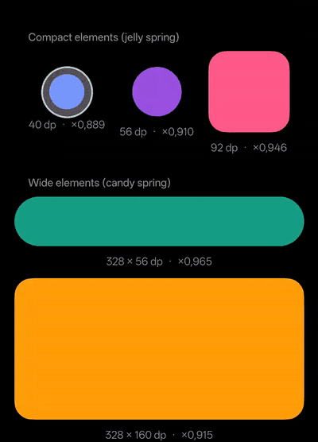
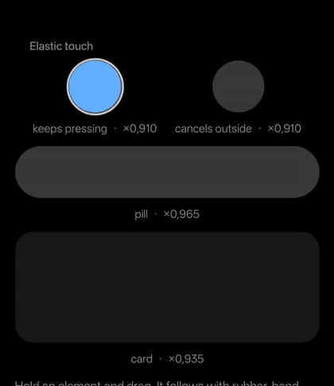
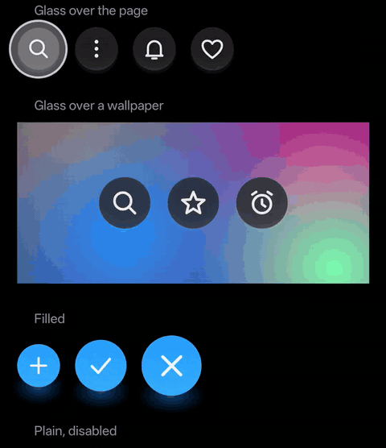
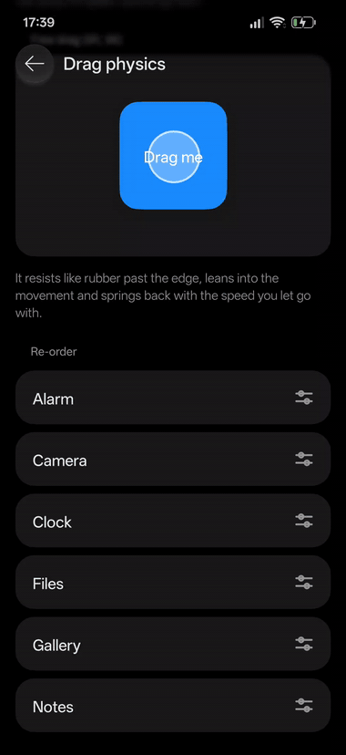
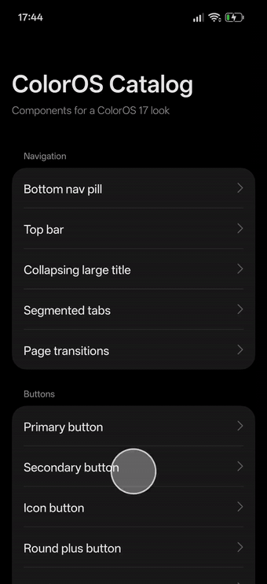

# Touch, drag, haptics and overscroll

<table>
<tr>
<td align="center" valign="top"><br><sub>Press animation</sub></td>
<td align="center" valign="top"><br><sub>Drag physics</sub></td>
<td align="center" valign="top"><br><sub>Glass buttons</sub></td>
</tr>
</table>

## The touch animation

Everything you can press in ColorOS 17 reacts the same way:

* it **shrinks** while held, by an amount that depends on its size and shape (a 40 dp button to 0.889, a 56 dp button to
  0.910, a 92 dp tile to 0.946, a full-width pill to 0.965),
* its fill gets **lighter**,
* if it is a Liquid Glass button it **follows the finger** with rubber-band resistance (at most 28 dp), growing along the
  drag and squeezing across it,
* on release it **springs back** with an overshoot that carries the speed the finger had.

`Modifier.touchMotion` is all of that. It does not consume a touch that only rests or moves a little, so a tap still
reaches the click handler; add the click next to it:

```kotlin
val shape = IrisTheme.shapes.pill
Box(
    Modifier
        .touchMotion(shape = shape)                 // before clip and background, so they move with it
        .clip(shape)
        .background(IrisTheme.colors.surfaceVariant)
        .irisClickable(onClick = { /* ... */ })
        .padding(horizontal = 24.dp, vertical = 14.dp),
) { IrisText("Share") }
```

The buttons of the kit already do this, so you only need the modifier for your own elements. The *Press animation* and
*Drag physics* screens of the [catalog](catalog.md#effects) let you try the sizes.

| Parameter | What it does |
| --- | --- |
| `shape` | The shape of the element, so the lighter fill stays inside it |
| `dragAxes` | Axes along which the element follows the finger (`TouchDragAxes.None` for a pure shrink) |
| `claimAxes` | Axes whose drags the element takes over (see [Who owns a drag](#who-owns-a-drag)) |
| `cancelOnLeave` | Spring back as soon as the finger leaves the element, like the real toolbar buttons |
| `pressedScale` | A fixed pressed scale instead of the one derived from the size |
| `highlightAlpha` | How much of the highlight color is mixed over the fill (0 for transparent elements) |
| `yieldToConsumers` | Cancel the motion when another gesture handler (a scrolling parent) takes the touch first |
| `state` | A `TouchMotionState` (`rememberTouchMotionState()`) to read or drive the animation |

The constants and formulas are in `TouchMotionDefaults` and `TouchMotionMath`; the behaviors were checked against the
phone, see the [README](../README.md#how-close-is-it-to-the-real-thing).

### Which elements drag

Only the Liquid Glass buttons of ColorOS follow the finger: the round icon buttons (also in the top bar), the bottom pill,
the round plus button, the pill buttons and the buttons of dialogs, the Cancel pill of the search bar, the segmented
control, the panel of a popup menu, sliders, and the large title with its subtitle and the top bar title.

List rows, cards, chips, checkboxes, switches and the windows of dialogs and sheets do not. They still shrink or light up
while held, but they pass `dragAxes = TouchDragAxes.None, claimAxes = TouchDragAxes.None`, so they neither follow the
finger nor take the touch from the list they sit in:

```kotlin
Modifier.touchMotion(shape = shape, dragAxes = TouchDragAxes.None, claimAxes = TouchDragAxes.None)
```

### Who owns a drag

Once the finger has moved a touch slop along an axis of `claimAxes`, the element *claims* the gesture: the click handler
inside it and every scrolling parent let go, so a list does not scroll while a button is dragged. The claim is made after
the handlers inside the element have had their say (a slider or a switch that drags its own thumb keeps the touch), and
before the parents get it. With `claimAxes = TouchDragAxes.None` the element leaves every drag to whoever else wants it.

## Free drag and re-ordering



`Modifier.physicsDrag` makes any element draggable in every direction with a rubber band past `maxDistance`, a lift while it
is held, a tilt from the drag direction and a springy return; haptics fire on grab and drop:

```kotlin
Box(
    Modifier
        .physicsDrag(maxDistance = 140.dp, liftScale = 1.06f, maxTilt = 9f)
        .size(120.dp)
        .clip(IrisTheme.shapes.card)
        .background(IrisTheme.colors.accent),
)
```

`ReorderableColumn` re-orders items by dragging their handle: the others shift out of the way on springs, the dragged item
lifts and settles into its slot on release.

```kotlin
ReorderableColumn(
    items = items,
    key = { it },
    onMove = { from, to -> items.add(to, items.removeAt(from)) },
) { item, dragging, handle ->
    Row(Modifier.fillMaxWidth().background(IrisTheme.colors.surface)) {
        IrisText(item, Modifier.weight(1f))
        Box(handle.size(56.dp)) { IrisIcon(IrisIcons.Tune, "Drag to re-order") }   // drag from here
    }
}
```

## Glows

* `Modifier.touchGlow(color, radius)`: a soft light that follows the finger inside the element and fades out after the
  release (the glow of the Clock bottom pill by default: 13.5 % white, about 140 dp). Apply `clip(shape)` before it. It only
  observes touches.
* `Modifier.persistentGlow(color, spread, offsetY, alpha, intensity)`: the always-on colored light under a button (round
  plus button, primary button, glass icon buttons), drawn behind the element, so give the parent room and do not clip it.
  `intensity` is read while drawing, so animating it never recomposes.

## Haptics

Components fire semantic `IrisHaptic` events through `LocalColorOSHaptics`; the engine turns them into vibrations:

| Events | |
| --- | --- |
| `Tap`, `Tick`, `Selection`, `Confirm`, `Reject` | General feedback |
| `ToggleOn`, `ToggleOff`, `SliderStep` | Switches, sliders |
| `DragStart`, `DragEnd`, `LongPress` | Dragging |
| `HeavyClick`, `Thud`, `Pop`, `DoubleClick` | The predefined effects of the vibrator |

```kotlin
val haptics = LocalColorOSHaptics.current
haptics.perform(IrisHaptic.Tick)
```

`IrisApp` provides a real engine (`AndroidColorOSHaptics`); outside it the default is `NoOpHaptics`, which does nothing.
`haptics.enabled` switches everything off. `haptics.source` chooses how events reach the motor:

| `HapticSource` | How |
| --- | --- |
| `ColorOS` | The haptic constants of ColorOS / OxygenOS devices (the default on OPPO, OnePlus and realme) |
| `System` | The standard `View.performHapticFeedback` constants (the default elsewhere) |
| `Direct` | Predefined `VibrationEffect`s sent straight to the vibrator |

When the chosen way is not possible the next one is tried. The stock apps are quiet: buttons, tabs, chips, cards and rows do
not vibrate, only toggles, the round add button and picker steps do, so `irisClickable` has no haptic by default. The
*Haptics* screen of the catalog plays every event.

## Overscroll



Every list, row and pager inside `IrisApp` gets the translating bounce of the stock apps at its ends instead of the Android
stretch: the content follows part of a pull, stays where it is while the finger rests, and returns on an ease-out of about
0.7 s; a fling that hits the end throws the content out first. It only ever reacts to what the list could not take, so a fling
that runs out in the middle of a list does not bounce.

```kotlin
IrisApp(overscrollFactory = null) { /* no overscroll at all */ }

// or for one subtree (the number wheel does this)
CompositionLocalProvider(LocalOverscrollFactory provides null) { /* ... */ }
```

Any other `OverscrollFactory` replaces the ColorOS one; `IrisOverscrollFactory` is the object to provide it again.

## Reference

* [API reference of `iris-effects`](api/iris-effects.md)
* [Catalog: Effects](catalog.md#effects)
